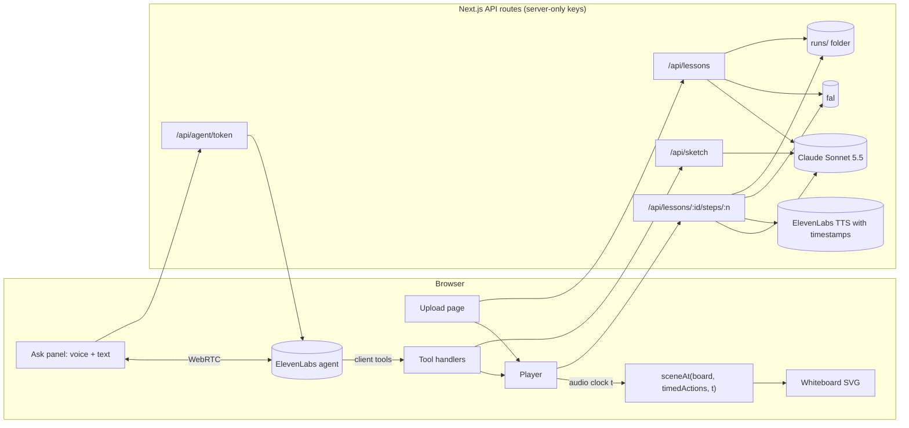
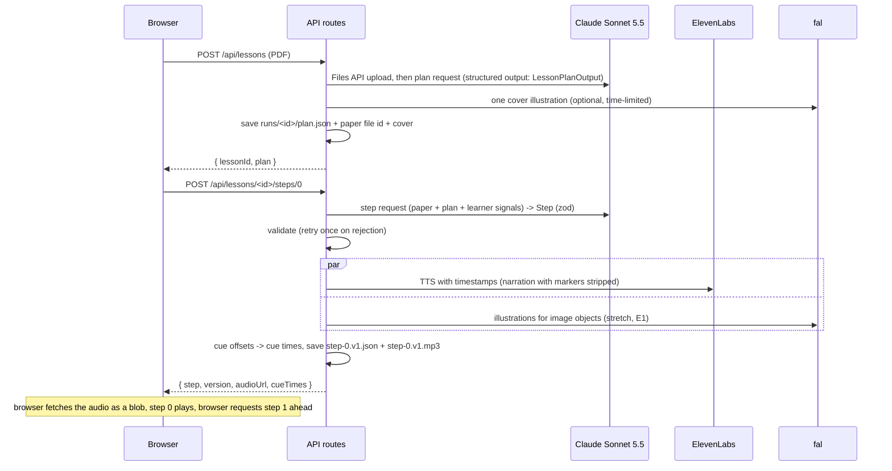
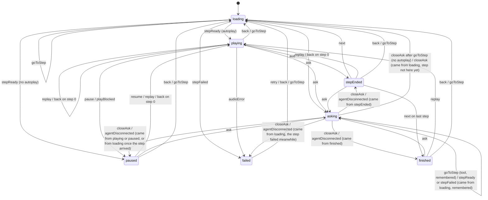
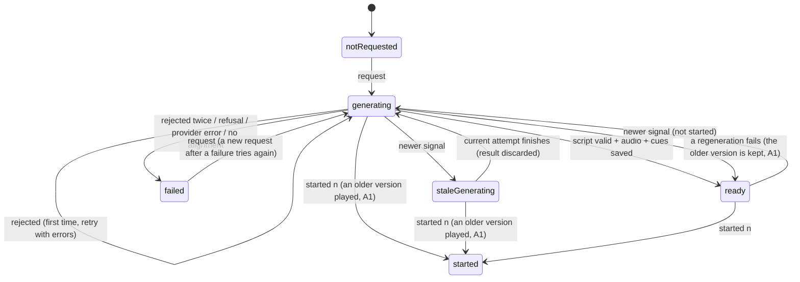

# Architecture

How the Visual-First AI Tutor runs, end to end. [`PROJECT_BRIEF.md`](../PROJECT_BRIEF.md) says **what** we're building and why. This file says **how**. [`ROADMAP.md`](ROADMAP.md) says **in what order**, and how each piece is proven to work.

Any change to a decision, a contract or a state machine in this file goes in the same PR as the code, and gets posted on the board.

## 1. Decisions

| Decision | Choice | Why |
|---|---|---|
| App | One **Next.js 16.4 (App Router) + TypeScript** app, on **Node 22** (pinned in `.nvmrc`, matching the laptops). The API routes are the backend. `cacheComponents` is off (create-next-app turns it on; we don't use it), and `next.config` sets `agentRules: false` so `next dev` doesn't rewrite `AGENTS.md`. | One language. The scene contract is written once and imported by both sides. |
| Runs on | **A local laptop**, as a production build (`npm run build && npm start`). | No serverless time limits on long generations. Local disk is the store. |
| Lesson LLM | **Claude Sonnet 5.5** (`claude-sonnet-5-5`) for the plan and every step. | Fast enough for live step generation. Set once in `lib/config.ts`. |
| Voice | **ElevenLabs** TTS with timestamps for narration. An **ElevenLabs agent** for Q&A, using the same voice. | Word-level timing for the lesson, and an interruptible agent for questions. |
| Q&A agent LLM | **Picked by spike S2**: two fast options from ElevenLabs' list, compared on the same questions. | It must answer in about a second and call tools reliably. |
| Agent config | **In the repo** (`agent/`), pushed to ElevenLabs with the official ElevenLabs CLI. | Prompts and tool definitions are reviewed in PRs and can't drift from the browser handlers. |
| Asking a question | **Voice or a typed message**, sent to the same agent. | A loud venue can break voice, so typing is the fallback. |
| Media | **fal**, server-side only. One cover illustration per lesson plan (M3), and illustrations on the whiteboard as stretch (E1). Optional: without `FAL_KEY`, images are hidden. | Precise diagrams are drawn by code. fal adds imagery. The budget is about 25 US dollars of fal credits per teammate, so generations are capped and cached. |
| Avatar | **None** (Anam dropped). | Removes the access risk. The bounties are Track 03 main, ElevenLabs and fal. |
| Generation | **Fully live**, with step N+1 generated while step N plays. Every run is saved to `runs/` and can be replayed offline. | Live by default, with a safety net if the network fails during judging. |
| Storage | **No database.** The `runs/<lessonId>/` folder is both the store and the replay set. | Fewer moving parts. |
| Papers | ***Attention Is All You Need*** is the **demo** paper. A second, different paper (non-ML or math-heavy, picked in spike S3) checks that the pipeline generalises. | Attention is very visual for the demo: matrix multiplication → dot-product attention → multi-head. But the product works for any paper: no paper-specific logic or concept lists in code or prompts. |
| Screen | **Desktop width, light theme** for the demo. | It's demoed on a laptop. Mobile and dark mode are out of scope. |

## 2. System overview



The app has two modes, kept separate on purpose:

- **Lesson mode, timed exactly.** Each scripted step is narration plus visual actions tied to words. Everything on the board follows the audio clock.
- **Q&A mode, loosely timed.** The learner interrupts and the voice agent answers. Its tools draw or highlight as it speaks, with no word-level timing.

Both modes draw through the same renderer, from the same scene contract.

## 3. Repo layout

```
app/
  page.tsx, UploadForm.tsx          upload page: PDF in, the plan as a list of step titles, then Start the lesson
  upload.ts                         the upload form field and the section 7 upload and plan messages (page and route)
  lesson/[lessonId]/page.tsx        player page
  api/lessons/route.ts              POST: PDF -> lesson plan, saved as runs/<id>/plan.json and paper.json
  api/lessons/[lessonId]/steps/[n]/route.ts   POST: generate step n (script + audio + cue times), or return it if it's ready; after a failure, a new POST tries again (section 6.2)
  api/sketch/route.ts               POST: Q&A drawing request -> sketch
  api/lessons/[lessonId]/signals/route.ts     POST: record a learner signal or "step n started" (section 5.4)
  api/runs/[lessonId]/[file]/route.ts         GET: serve step JSON, audio and media from runs/ (no path traversal)
  api/agent/token/route.ts          GET: ElevenLabs conversation token
  dev/board/page.tsx                dev only: renders a fixed BoardState, or demo-m1 at ?t= via sceneAt (renderer tests); 404 in production unless in fake mode (FAKE_APIS=1, no REPLAY_RUN)
  dev/board/scenes.ts               the dev page's fixed BoardState and demo-m1 scenes
  dev/player/page.tsx               dev only: the player with a fake two-step lesson (player tests); same gate (dev/devOnly.ts)
  dev/player/audio/route.ts         dev only: that lesson's silent audio (or broken, or missing)
  dev/ask/page.tsx, AskDemo.tsx     dev only: the Ask panel driven by the player machine and a fake three-step lesson (?replay=1 as in a replay run); same gate
instrumentation.ts                  register(): validates env once at server start (not at build)
shared/                             imported by server and browser (the contract)
  scene.ts                          zod schemas: board objects, actions, step, sketch, board state
  lesson.ts                         zod schemas: lesson plan, API responses
  validate.ts                       checks that zod can't express (ids, cues, bounds)
  latex.ts                          KaTeX options for untrusted tex (validator and renderer)
  tools.ts                          the client tool names and parameter schemas (one list for the agent config and qa/tools.ts)
lib/                                server-only (import "server-only")
  config.ts                         model ids, effort, limits, paths: one place
  env.ts                            reads and validates env vars once
  pipeline/plan.ts, step.ts, sketch.ts, generate.ts (one structured-output request, validated and retried once), pdf.ts (the byte checks before upload), prompts/, outputFormat.ts (the wire format Claude fills in for steps and sketches, its converters, and the plan's schema)
  narration/cues.ts                 pure: strip markers, cue offsets -> times
  narration/tts.ts                  ElevenLabs TTS with timestamps -> audio + cue times (S1 fixture when FAKE_APIS=1)
  narration/makeM1.ts               npm run make:m1: demo-m1.step.json -> runs/demo-m1/ (plan.json, step-0.v<k>.json + .mp3)
  agent/token.ts                    the Q&A agent's conversation token (fixture when FAKE_APIS=1)
  media/fal.ts                      fal (S4's model): one image from a prompt, downloaded at once; none without FAL_KEY or in replay, the fake when FAKE_APIS=1
  media/cover.ts                    the lesson cover (L4): one image per plan, saved as cover.jpg, under its own deadline
  runs/store.ts                     read/write runs/<lessonId>/
  fakes/                            fake Claude/ElevenLabs/fal for tests (FAKE_APIS=1)
player/                             browser
  sceneAt.ts                        pure: board state at time t
  machine.ts                        pure: player state machine (section 6)
  Whiteboard.tsx, primitives/       matrix, text, latex, arrow, image
  usePlayer.ts                      audio element, clock, controls
  stepLoader.ts                     a step's request, then its audio as a blob; only the latest request reports back
  controls.ts                       pure: which controls are enabled, key and play() results -> events
  Player.tsx                        the whiteboard, controls, status and the ?debug=1 overlay
qa/                                 browser
  conversation.ts                   adapter over @elevenlabs/react useConversation; a scripted fake when NEXT_PUBLIC_FAKE_APIS=1
  fakeConversation.ts               the scripted fake: canned agent turns, calls tool handlers (window.__qaFake in fake builds, for Playwright)
  types.ts, callTool.ts             the adapter's types; a tool call checked against shared/tools.ts, then handled
  context.ts                        pure: the sendContextualUpdate() message, and the narration heard by time t
  AskPanel.tsx                      voice + typed input, through conversation.ts; shows the Ask messages of section 7
  tools.ts                          client tool handlers, typed by shared/tools.ts
scripts/                            dev scripts, run with tsx: make:m1 (make-m1.ts), seed:m2, spike:s3, spike:s4 (s4-spike.ts)
agent/                              ElevenLabs CLI config: the agent (prompt, voice, LLM) and its client tools, plus the CLI's tracking file
runs/                               gitignored: one folder per lesson (store + replay)
tests/e2e/                          Playwright, with FAKE_APIS=1 and NEXT_PUBLIC_FAKE_APIS=1
evidence/                           gitignored: screenshots and recordings for PRs
```

There are two ownership areas, and the folders of each are in the `AGENTS.md` §4 table:
- **A, browser:** the contract, the player and the Q&A browser side.
- **B, server:** the pipeline, the API routes (including `/api/sketch`), voice (`agent/`) and fal.

Task owners go on the GitHub issues. Files every task touches (`package.json`, `lib/config.ts`, `lib/env.ts`, `instrumentation.ts`, `.env.example`, `lib/fakes/`, `tests/e2e/`, `.github/`, `app/layout.tsx`) can be edited by anyone, with a post on the board.

## 4. The scene contract (`shared/scene.ts`)

This is the one contract between the step generator, the renderer and the Q&A tools. A change to it is posted on the board before it merges. The first version is deliberately small (what milestone M1 needs). New primitives get added only when a lesson needs them, and only as general primitives, never for one paper.

```ts
// Virtual canvas: every coordinate is in a 1600 x 900 viewBox, origin top-left.
// Matrix cells have a fixed size, CELL = 64 x 48 (w x h), so a board can be laid out without overlaps.
type ObjectId = string;                       // /^[a-z][a-z0-9_]{0,31}$/

type BoardObject = (                          // discriminated on `kind`
  | { kind: "matrix"; id; x; y; rows: string[][]; label?: string }   // 1..8 x 1..8 cells ("" is an empty cell); x,y is the top-left corner
  | { kind: "text";   id; x; y; text: string; size?: "s" | "m" | "l" }   // x,y is the centre of the text
  | { kind: "latex";  id; x; y; tex: string }                        // x,y is the centre
  | { kind: "arrow";  id; from: Anchor; to: Anchor; label?: string }
  | { kind: "image";  id; x; y; w; h; prompt: string }      // fal illustration, x,y top-left; the server adds mediaUrl
) & { hidden?: boolean };                     // true: not drawn until a `show` (default false)

type Target = { id: ObjectId; row?: number; col?: number };  // an object, or a row, column or cell of a matrix (0-based)
type Anchor = Target | { x: number; y: number };             // the centre of a target, or a point

type Action =
  | { do: "show" | "hide"; target: Target }
  | { do: "highlight" | "unhighlight"; target: Target; color?: "accent" | "warn" }
  | { do: "move"; target: Target; to: Anchor }               // the target's centre ends on the anchor
  | { do: "write"; target: Target; value: string };          // a matrix cell's value, or a text object's text
// Every action also carries durationMs (0..3000, default 400).

type Step = {                                 // what Claude writes for one lesson step
  title: string;
  narration: string;                          // with cue markers: "Take the first [[row1]]row..."
  objects: BoardObject[];                     // the board when the step starts
  actions: (Action & { cue: string })[];      // fired when the cue's word is spoken
};

type Sketch = {                               // what /api/sketch returns for a Q&A drawing
  objects: BoardObject[];                     // added to the current board, or to an empty one with fresh (section 8)
  actions: (Action & { atMs: number })[];     // fired at a time offset, no narration
};
```

- `mediaUrl` isn't part of the schema Claude fills in. The server adds it after fal returns and the image is saved to `runs/`. The page never loads a URL that a model wrote.
- When several actions start at the same time, `sceneAt` applies them in their array order.
- **Geometry.** Cell (r, c) of a matrix at x,y has its centre at (x + 64c + 32, y + 48r + 24). Brackets and the label are drawn outside that box. A whole matrix's centre is the centre of its cell box. The centre of a row or column is the centre of its cells, an arrow's is the midpoint of its ends, and an image's is the middle of its box. `CELL` is exported from `shared/scene.ts`, and the renderer and the prompts both use it.
- **Hidden objects.** An object with `hidden: true` is on the board from the start but isn't drawn until a `show`. That's how product terms and sums appear partway through a step.
- **Moving part of a matrix.** `move` on a whole object moves it. `move` on a row, column or cell slides a **copy** of those cells (same values and highlight), so the source matrix stays whole, with no gap. Each row, column or cell gets its own copy the first time it moves. After that, an anchor or a later `move` naming that part uses the copy, `hide` on the part removes the copy, and `highlight`, `unhighlight` and `write` change the source cells and the copy together. The source cells are never hidden on their own.
- **Arrows** are drawn between their anchors where they are now, so an arrow follows an object that moves. An arrow itself can't be moved.
- **Writing.** `write` replaces a matrix cell's value or a text object's text, so a text showing `1·5 + 2·7` can become `19` and then move into a cell.

**The M1 demo in this contract** (`lib/fakes/fixtures/demo-m1.step.json`, hand-written in F3 as the contract's acceptance test). Matrices `a` and `b` and an empty result `c` are visible; `p1` (`1·5`), `p2` (`2·7`) and `sum` are hidden `text` objects.
1. `[[row]]`: highlight row 0 of `a`. `[[col]]`: highlight column 0 of `b`. `[[slide]]`: two `move` actions on this one cue, row 0 of `a` (a copy) to a point left of `c` and column 0 of `b` (a copy) to a point beside it. The row and column slide together.
2. `[[pair1]]`, `[[pair2]]`: show `p1`, then `p2`. The pairs multiply.
3. `[[add]]`: show `sum` with `1·5 + 2·7`. `[[total]]`: write `19` to `sum`.
4. `[[drop]]`: move `sum` to `{ id: "c", row: 0, col: 0 }`. `[[done]]`: write `19` to that cell, hide `sum` and hide both copies. The sum has dropped into (1,1), the first cell.

**`shared/validate.ts`** checks the rules zod can't express. It runs on the server after Claude responds and in the browser before a tool draws. Each row gets a test.

| Input | Result |
|---|---|
| Every rule holds | valid |
| The output isn't JSON, or fails the zod schema (`validateStep` parses it, section 5.1) | rejected: `the output is not valid JSON`, or the schema error |
| A cue in `actions` doesn't appear in `narration` | rejected: `unknown cue "x"` |
| A marker appears twice in `narration` | rejected: `duplicate cue "x"` |
| A malformed marker (`[[Row 1]]`, a stray `[[` or `]]`) | rejected: `malformed marker "[[Row 1]]"` (otherwise it would be read aloud) |
| A marker in `narration` that no action uses | allowed (it's ignored) |
| A `target.id`, or an anchor's `id`, with no object | rejected: `unknown object "x"` |
| `row` or `col` outside the matrix, or set on a non-matrix (in a target or an anchor) | rejected: `target out of range "x"` (x is the id the target or anchor names) |
| `write` on a matrix without both `row` and `col` | rejected: `write needs a cell` |
| `write` on a `latex`, `arrow` or `image` | rejected: `can't write to "x"` |
| `show` with `row` or `col` | rejected: `show needs a whole object` |
| `move` on an `arrow` | rejected: `can't move "x"` |
| `show` on a visible object, `hide` on a hidden one, or `hide` on a part that hasn't moved | allowed (no change) |
| `tex` that KaTeX can't parse, or that uses a command `trust: false` refuses (`\href`, `\url`, `\includegraphics`, `\htmlClass` and the like) | rejected: `invalid LaTeX in "x"` (the renderer also uses `throwOnError: false` as a safety net) |
| An object, or an `{x, y}` point in an anchor, outside the 1600 × 900 canvas (for a matrix, its whole cell box; for `text` and `latex`, only their x,y) | rejected: `off canvas "x"` (x is the object, an arrow for its own point ends, or for a `move` to a point, the object that moves) |
| Two objects with the same id | rejected: `duplicate id "x"` |
| Narration longer than `config.maxNarrationChars` after the markers are stripped | rejected: `narration too long` |
| Narration with nothing left after the markers are stripped (only markers or spaces) | rejected: `narration empty` (TTS would fail after validation, too late to retry) |
| An arrow end that names an arrow (itself, or arrows anchored to each other) | rejected: `can't anchor to "x"` (an arrow's centre is the midpoint of its ends, so it would have no position) |
| A sketch action or anchor uses an id from the board the sketch draws on | valid |
| The same, with `fresh: true` (the board is empty) | rejected: `unknown object "x"` |
| A sketch object reuses an id from the board it draws on | rejected: `duplicate id "x"` |
| (wire format) A `move` with no `to` | rejected: `move needs to "x"` (x is the target's id; the action is dropped and the rest is still checked) |
| (wire format) A `write` with no `value` | rejected: `write needs value "x"` (as above) |
| (wire format) A field the action's kind doesn't take (`to` on a `show`, `color` on a `write`) | allowed (dropped, as zod drops unknown keys) |

For a sketch, the known ids are its own objects plus those of the board it draws on (section 8).

**The wire format (`lib/pipeline/outputFormat.ts`, #57).** Claude doesn't fill in this contract's schema directly: the API rejects `zodOutputFormat(Step)` and `zodOutputFormat(Sketch)` with "The compiled grammar is too large", because of the object union times the action union (S3, #27). So Claude fills in `WireStep` or `WireSketch`: the same objects, but every action is one flat object with `do` an enum of the six kinds and `color`, `to` and `value` optional. `validateWireStep` / `validateWireSketch` parse the wire, convert it with `wireToStep` / `wireToSketch` (pure), then run `validateStep` / `validateSketch` unchanged, and return the conversion's errors and the contract's in one list for the one retry. A parsed contract `Step` or `Sketch` is already a valid wire value, and converting it back gives the same value (a round-trip property test). The wire gives each action field the contract's own constraints, so a schema error names the action's index on the wire, and it requires `durationMs`, which the contract defaults to 400. `shared/` and the player never see the wire format. Neither wire schema has headroom (S3: one more object kind is rejected), so a new primitive needs a real request with the bigger schema before it merges; a size-budget test catches a schema that grows.

When generation is rejected (output that isn't JSON, a zod schema error or a `validate.ts` rejection), the generator retries **once**, with the error messages added to the prompt. If the retry also fails, the step fails (section 6.2).

## 5. Lesson mode

### 5.1 Making a lesson



- **The paper goes to Claude directly.**
  - It's uploaded once with the Files API (`client.files.upload`).
  - Every plan and step request then references it by `file_id`, as a `document` block.
  - The upload size cap (`config.maxPdfMb`) is our own choice, not Claude's limit. We don't parse the PDF, but `lib/pipeline/pdf.ts` checks its bytes before uploading: the `%PDF-` header within the first 1024 bytes, the size, an `/Encrypt` entry and a count of `/Type /Page` objects over `config.maxPdfPages` (Claude's 600-page limit). That catches the common cases without a paid request. When Claude rejects a PDF the checks missed (pages hidden in compressed object streams, an unreadable file), it answers 400, and we return the same upload error in section 7.
  - The run folder gets `paper.json` (`PAPER_FILE` in `lib/runs/store.ts`, beside `PLAN_FILE`; `{ fileId, filename }`, the paper's Files API id for the step requests) and then `plan.json`, last, so a lesson the page can open is always complete. The lesson id is the plan title's slug plus 8 random hex characters. `POST /api/lessons` answers `{ lessonId, plan }`, or `{ error }` with a section 7 message: 400 for no file or not a PDF, 413 over the size cap (checked on `Content-Length` before the body is read, then on the file), 422 for an encrypted PDF, too many pages or a PDF Claude rejects, 502 when Claude fails to plan or upload, and 500 for anything else. The reason goes to the server log.
- **Caching.** The document block carries `cache_control: { type: "ephemeral", ttl: "1h" }`, so later step requests reuse the cached paper. The 1-hour cache outlasts long Q&A pauses and rehearsals. Its writes cost more than the 5-minute cache's, but each request type writes the paper only once. For the cache to work:
  - The step system prompt must be byte-identical for every step.
  - The plan, goal and signals go *after* the document block.
  - The plan request uses a different output format, so it builds its own cache. Its document block uses the 5-minute cache, which covers the plan's one retry.
  - A sketch request carries no paper (its body has no lesson), so it has no document block and no cache: just the board and the description (section 8).
- **Structured output.** Requests stream: `client.messages.stream({ output_config: { format } })`, then `await stream.finalMessage()`. For a step, `format` is `lib/pipeline/outputFormat.ts`'s JSON schema for the wire format (`zodOutputFormat(WireStep).schema`, from `@anthropic-ai/sdk/helpers/zod`; section 4), and a sketch uses `WireSketch`.
  - The generator checks `stop_reason` first: `refusal`, `max_tokens` and `model_context_window_exceeded` fail the step (section 6.2). Each attempt has a total deadline (`config.step.timeoutMs`, an abort signal), since the SDK's own `timeout` stops counting once a stream's headers arrive. Otherwise it parses the text itself with `validateWireStep` (the wire schema, the conversion, then `validateStep`), not the SDK's `parsed_output` (whose parser throws before a refusal can be seen). So a schema failure, including constraints the API can't enforce (number ranges, item counts), a conversion error and a `validate.ts` rejection give the same error list for the one retry.
  - The retry resends the first request, then Claude's rejected answer (unchanged, thinking included) and the errors, so it reuses the cached paper.
  - Effort per request type (plan, step, sketch) is set in `lib/config.ts`.
  - The contract's own `Step` schema is rejected with "The compiled grammar is too large" (S3, G1, #27), so requests send the wire format (section 4). On 2026-11-14 a real request accepted both `WireStep` and `WireSketch`, and one real step (Attention paper, scaled dot-product scores, `medium` effort) was valid on the first try in 9.3 s with 926 output tokens. That response is the `FAKE_APIS=1` step fixture (`lib/fakes/fixtures/claude-step.message.json`).
- **Prompts are generic.** No paper-specific logic, hard-coded concept lists or examples taken from the demo paper, in prompts or code. Paper-specific content lives only in fixtures and demo checks.
- **Prompts** live in `lib/pipeline/prompts/`. A step prompt receives:
  - the plan and the step's goal
  - the previous step's narration if it has been generated, otherwise that step's goal from the plan (needed after a jump)
  - the learner signals (section 5.4)
- **Cover illustration (fal).** The plan includes a `coverPrompt`. Once the plan is made, and before `plan.json` is saved, `lib/media/cover.ts` asks fal for **one** image (`config.fal.model`, S4), downloads it at once (fal's URLs expire) and saves it in the run folder as `cover.jpg` (`config.cover.file`). It records that name as `cover` in `plan.json` and in the plan response. The upload page's plan view shows it, and the lesson page shows it as a header. Both hide the image if it fails to load.
  - It sits outside the scene contract and `sceneAt`: it's page chrome, not a board object.
  - The plan route waits for it up to `config.cover.timeoutMs` (6 s; S4 saw 4.4–4.6 s with the download). That deadline is the cover's own: a race against a timer around the fal call and the download, since `fal.subscribe`'s `timeout` doesn't cover the whole call. When it passes, the request is aborted and fal is asked to cancel it once it has a request id (fal can't cancel one already running, and an abort before fal answers the submit has no id, so a late image may still be charged). If fal is slow, fails, sends something that isn't a JPEG by its first bytes, or has no `FAL_KEY`, the plan is returned and saved without `cover`, the pages show no image, and the reason is logged. The timeout is kept to a few seconds, since step 0 is requested after the plan returns.
  - Budget: about 25 US dollars of fal credits per teammate. So it's one image per lesson plan, a saved cover is never regenerated, replay never calls fal, and tests use the fal fake.
- **Files reach the browser through `GET /api/runs/<lessonId>/<file>`.** `runs/` is outside `public/`, and `next start` won't serve files added after the build.
  - The player fetches each step's audio as a blob and plays it from a `blob:` URL. That keeps seeking reliable without HTTP Range support in the route.
  - The route only serves names matching `^[a-z0-9][a-z0-9.-]{0,99}$` (so never `.` or `..`) with a known extension (`.json`, `.mp3`, `.png`, `.jpg`, `.jpeg`, `.webp`) from inside the run folder, and never a symlink or a folder. A bad `lessonId` or file name → 400; a file that isn't there → 404.
  - `lib/runs/store.ts` writes every file atomically (a temporary file, then a rename, or a hard link for step versions so they never replace a file), so a reader never sees half a file. A new step version is saved with `saveStepVersion`: its audio `step-<n>.v<k>.mp3` first (creating it claims version k; if k is taken, it tries the next version, and gives up with an error after 100 tries), then `step-<n>.v<k>.json`, so an older version is never overwritten and a listed version always has its audio.
  - A step file holds `SavedStep` (`shared/lesson.ts`): `{ step, cueTimes }`. Its version and audio URL come from its name, so a saved step becomes a `StepResponse` without the step route. Writers (C1 `make:m1`, the step route) parse with `SavedStep` before `saveStepVersion`, and a run that's played on the lesson page also needs `plan.json` (`make:m1` writes it too).
  - **The lesson page** (`app/lesson/[lessonId]/page.tsx`) reads `plan.json` and lists the saved step versions on the server (the browser can't list a run folder). The player then reads each step's latest saved version, `step-<n>.v<k>.json`, and its `.mp3` through this route. A bad `lessonId` or a lesson with no `plan.json` is a 404 page with "No such lesson or step." and a link back to upload; a step with no saved file fails in the player with "This step isn't in the saved run." Once the step route exists, it replaces the page's direct reads for steps not yet generated. Playing the step version recorded in `signals.json` waits for S1 (it plays the latest until then).

### 5.2 Cue markers become times (`lib/narration/cues.ts`, pure)

1. The markers match `\[\[([a-z][a-z0-9_]{0,31})\]\]`. Stripping them, trimming the text and collapsing whitespace gives the text sent to TTS, plus a map from each cue to the character offset where its marker was.
2. ElevenLabs `POST /v1/text-to-speech/{voice_id}/with-timestamps` returns `audio_base64` and `alignment`, with `characters`, `character_start_times_seconds` and `character_end_times_seconds`.
3. The offsets → times map is built by **walking `alignment.characters` against the text we sent**, rather than assuming the arrays line up index for index. ElevenLabs may count characters differently from JavaScript (code points vs UTF-16).
4. Each cue's time is the start of the first non-space character at or after its offset. A cue at the very end gets the last character's end time.

| Input | Result |
|---|---|
| No markers | the text unchanged, no cues |
| A marker mid-word (`ro[[c]]w`) | its time is the start of `w` |
| Two markers back to back | both get the same time |
| A marker at the end | the last character's end time |
| A cue named like an `Object.prototype` key (`constructor`) | it gets its own time, like any other cue |
| Unicode (é, emoji, CJK) in the narration | the walk matches characters one by one, so the cues still land correctly |
| The alignment skips or adds characters (normalisation) | the walk resyncs on the next matching character, and the cue takes the nearest following time |
| `alignment` is null, or the walk can't match at all | error `no alignment`: the step fails (section 6.2), logged with the text and response |

Property-based tests (fast-check) check three things:
- stripping then reinserting the markers gives back the original text
- cue times never decrease in text order
- walking an alignment generated from the text itself gives exact times

### 5.3 The player is a function of time (`player/sceneAt.ts`, pure)

```ts
sceneAt(objects: BoardObject[], timed: { action; startMs; durationMs }[], tMs: number): BoardState
```

- `BoardState` (a zod schema in `shared/scene.ts`, since `/api/sketch` receives it) is every object with its visibility, highlight, position and value at `tMs`, plus the moved copies of matrix parts. For each action in progress, it also includes how far along it is (0..1) and, for a matrix highlight, unhighlight or write, the cells it changed.
- **Lesson mode:** `timed` comes from `cueTimes`, and `tMs` is `audio.currentTime * 1000`.
- **Q&A mode:** the lesson board stays at `pausedT`, with the Q&A drawing on top (section 8). `objects` is the step's objects plus each sketch's objects. `timed` is the step's actions that started by `pausedT`, plus each Q&A action at `pausedT` + the time since Ask opened when it arrived (+ `atMs` for a sketch). `tMs` is `pausedT` + the time since Ask opened. After a `fresh` sketch, the step and earlier sketches are left out.
- **Timing rules** (what `sceneAt` does with each action):
  - Actions apply in start order. Actions that start at the same time apply in their array order.
  - `show`, `highlight`, `unhighlight` and `write` take effect when they start. `hide` takes effect when it ends, so the renderer can fade it out using progress.
  - `move` slides in a straight line from where its target was when the move started to where its anchor was then. Its path doesn't change if the anchor moves later.
  - An action is in `active` while `startMs <= tMs < startMs + durationMs`. A 0 ms action is complete at its start and never active.
  - An action that changes nothing is never in `active`: one that, once complete, would leave the board as it would be with every earlier action complete (for a `hide`, which takes effect when it ends: with the earlier actions as they are then, so a shorter `hide` during a longer one is active). For example a `show` of a visible object, a `highlight` in the colour its cells already have, or a `write` of the value already there. So the renderer doesn't fade in an object, value or highlight that is already there. The check is per action: a highlight that changes some of its cells is active.
  - A `highlight`, `unhighlight` or `write` on a matrix also lists its `cells` in `active`: the cells [row, col] it changed (judged as above) that no later started action has changed since (a later `highlight` or `unhighlight` for a highlight, a later `write` for a write). The renderer fades in only those, so a cell that already had the colour or value doesn't blink, and a cell a later 0 ms action has set is shown at once.
  - A `show` that starts while a `hide` of the same object is in progress takes over with no jump: the renderer shows the larger of the two opacities, so the object keeps fading until the show overtakes the hide, then fades in. Once the show ends, the hide leaves `active` (the show applies after it, so the object stays visible). A `hide` during a `show` mirrors this with the smaller opacity: the object keeps fading in until the hide overtakes the show.
  - `unhighlight` with a `color` clears only that colour. Without one, it clears every colour.
  - A whole-matrix highlight sets every cell in `cellHighlight`. A matrix's own `highlight` stays `null`.
  - Actions on unknown or out-of-range targets are ignored and never listed in `active`. `validate.ts` rejects them first.
  - When a `hide` on a moved part ends, its copy leaves `copies`. Anchors naming that part then resolve to the source cells, and a later `move` of it makes a fresh copy.
  - A copy is independent of its matrix once made: hiding or moving the whole matrix leaves its copies where they are.
  - `player/sceneAt.ts` also exports `timeline(actions, cueTimes)`, which builds `timed` in lesson mode, and `resolveAnchor(board, anchor)`, which gives the renderer arrow ends. The renderer reuses its target helpers (`partKey`, `isPart`, `coversCell`, `highlightColor`) rather than copying them.
- Back, Replay and scrubbing are just seeks on the audio element. There's no animation state to undo.
- `Whiteboard.tsx` renders `BoardState` as SVG on each animation frame. Positions (moves included) come from `sceneAt`; the renderer only fades shows, hides, highlights and writes by each action's progress, and exposes state as `data-*` attributes for tests.
- **Latex and arrows on the board.** `latex` is KaTeX's HTML in a `foreignObject` centred on x,y, rendered with `shared/latex.ts`'s `KATEX_OPTIONS` (trust off, `maxSize` and `maxExpand` capped; `validate.ts` uses the same options, and rejects tex that uses a command trust refuses) and `throwOnError: false`, so tex that slips through shows as KaTeX's red source text instead of breaking the board (if KaTeX fails outright, the source shows as plain text). An arrow resolves its ends with `resolveAnchor` on every frame. An end on a point is exact; an end on a target stops just outside the target's box (cells, text box, image; for latex, a box estimated from KaTeX's output, since its real size is only known after layout), so the head doesn't cover what it points at. The label sits beside the middle of the line, far enough out that its box clears it. `data-from-*`/`data-to-*` are the resolved anchors.
- Motion is only used for UI chrome, such as panels and buttons, not for board objects, so the board always matches the clock.

### 5.4 Adaptation

- **Recording signals.** The browser posts to `POST /api/lessons/<id>/signals`. The body is validated with zod and holds one of:
  - a question: the agent's user transcript (from `onMessage`) or typed text
  - a simplify request from `simplify_upcoming`
  - `{ started: n, version: k }` when version k of step n starts playing

  The server appends it to `runs/<id>/signals.json` and bumps the lesson's **signals version**.
- Every step generation records the signals version it used.
- When a question or simplify signal arrives, any step that **hasn't started playing** is out of date if it was generated (or is still generating) with an older version:
  - The server marks it stale and regenerates it as soon as the current generation finishes (section 6.2).
  - The browser keeps its prefetched copy of N+1 and requests the step again. When Next is pressed, it plays the new version if it has arrived, and otherwise the copy it already has, so Next never waits for a regeneration.
- A step that has started playing is kept as it is. A regeneration still running for it is discarded when it finishes.
- A regeneration that fails keeps the older version: the step stays playable.

### 5.5 Replay safety net

- Everything generated is written to `runs/<lessonId>/`: `plan.json`, the cover, `step-<n>.v<k>.json`, the audio, cue times and media for each step, and `signals.json`.
- Steps are **versioned** (`v1`, `v2`, ...) because a signal can regenerate one. `signals.json` records which version of each step started playing.
- Starting the app with `REPLAY_RUN=<lessonId>`:
  - The upload page redirects to `/lesson/<lessonId>`.
  - The routes serve each step's *played* version, or its latest version if it never played, from the folder. They never call Claude, ElevenLabs or fal.
  - A step that isn't in the folder fails, with "This step isn't in the saved run."
- Q&A needs the network, so in replay mode the Ask panel says "Q&A needs a connection".

## 6. State machines

### 6.1 Player (`player/machine.ts`, pure)



`loading` carries the step it's loading and whether to **autoplay**: yes for Next, Back and goToStep; no after a Q&A jump. `stepReady(i)` and `stepFailed(i)` carry their step index. Entering `loading` requests the step, so Retry from `failed` is just a new request: the server returns the saved step, or generates it again if it failed (section 6.2). An event for a step other than the one being loaded is a late reply to an earlier request: it's ignored and logged. Ask can open while a step loads (a step that wasn't prefetched can take a while, which is when the learner wants to ask). The step keeps loading, and the result is remembered for when Ask closes.

Every state × event pair has a defined result, and each cell gets a test:
- **ignored** means the state doesn't change and nothing is shown.
- **rejected** means the state doesn't change and the learner is told why.
- **can't happen** gives the reason. The machine still treats these as ignored, and logs a warning.

| State \ event | stepReady(i) / stepFailed(i) | audioEnded | playBlocked | audioError | pause | resume | replay | ask | closeAsk | agentDisconnected | next | back | goToStep(n) | retry |
|---|---|---|---|---|---|---|---|---|---|---|---|---|---|---|
| loading(k) | i = k: → playing (autoplay) or paused, or → failed with the server's message ("Couldn't make this step. Retry?", or in replay "This step isn't in the saved run."). i ≠ k: ignored (late reply) | can't happen (no audio) | can't happen | can't happen | ignored | ignored | ignored | → asking (remembers loading(k); the step keeps loading) | can't happen (not asking) | can't happen | ignored | ignored | → loading(n) | ignored |
| playing | ignored (late reply) | → stepEnded | → paused, with "Press play to start" | → failed ("Couldn't play the audio. Retry?") | → paused | ignored | seek to 0, stays playing | → asking (narration paused) | can't happen | can't happen | ignored (Next only after the step ends) | → loading(prev), or seek to 0 on step 0 | → loading(n) | ignored |
| paused | ignored (late reply) | can't happen (audio stopped) | can't happen | ignored | ignored | → playing | seek to 0 → playing | → asking | can't happen | can't happen | ignored | → loading(prev), or seek to 0 → playing on step 0 | → loading(n) | ignored |
| stepEnded | ignored (late reply) | can't happen | can't happen | ignored | ignored | ignored | seek to 0 → playing | → asking | can't happen | can't happen | → loading(next), or → finished on the last step | → loading(prev), or seek to 0 → playing on step 0 | → loading(n) | ignored |
| asking | Ask opened from loading(k) and i = k: remembered for closeAsk. Otherwise ignored (late reply) | can't happen (narration paused) | can't happen | ignored | ignored | ignored | ignored | ignored | → the state Ask was opened from (playing becomes paused; loading(k) becomes paused, or failed with the server's message, if step k's result arrived meanwhile, and otherwise stays loading(k)), or → loading(n, no autoplay) if the agent called goToStep(n). The Q&A drawing is discarded and the board is `sceneAt(step, pausedT)` again (or the arrived step at 0, from loading) | same as closeAsk, plus "Q&A ended unexpectedly." | ignored | ignored | stays asking, remembers n (agent tool) | ignored |
| failed | ignored (late reply) | can't happen | can't happen | can't happen | ignored | ignored | ignored | rejected: nothing to ask about | can't happen | can't happen | ignored | → loading(prev), or ignored on step 0 | → loading(n) | → loading(same) |
| finished | ignored (late reply) | can't happen | can't happen | ignored | ignored | ignored | seek to 0 → playing | → asking | can't happen | can't happen | ignored | → loading(last) | → loading(n) | ignored |

- `goToStep(n)` with `n` outside the plan is **rejected** in every state: the agent tool returns `"no step n"` and the state doesn't change.
- When the agent jumps steps during Q&A, it finishes speaking. The new step loads paused once Ask closes, so the narration never talks over the agent.
- `playBlocked` is the browser refusing `audio.play()` without a user gesture, for example after a page reload.
- **Where the events come from** (`player/usePlayer.ts`, `player/stepLoader.ts`). The hook runs the effects and turns the browser's signals into events:
  - `loadStep` requests the step, then fetches its audio as a blob. `stepReady(i)` is sent once both have arrived, and the step is kept only if the machine takes it. A step request that fails sends `stepFailed(i)` with the server's message, or "Couldn't make this step. Retry?" when there is none (network down). An audio download that fails sends `stepFailed(i)` with "Couldn't play the audio. Retry?". Only the latest request can report back: an older one that finishes later, in success or failure, is dropped and logged.
  - `audio.play()` rejected with `NotAllowedError` sends `playBlocked`. Its other rejections are left to the element's `error` event, which sends `audioError` (so a decode error isn't sent twice). Playing an element that already failed (its error was ignored while paused) sends `audioError`.
  - The audio plays exactly while the state is `playing`. A pause from outside the page (a media key) while playing sends `pause`. A play from outside sends `resume`, and if the machine ignores it, the audio is paused again.
  - A control is enabled exactly when its event would change the state. Space sends `pause` while playing and `resume` otherwise, but not with a modifier key, on key repeat, or on an interactive element (a text field, button, link or select, where Space already does something).

### 6.2 Step generation (per step, on the server)



| State \ event | request | rejected (zod or validate) | valid + audio + cues | refusal / Claude error after SDK retries / `max_tokens` cut-off | TTS or quota error, no alignment | newer signal (A1) | started n (A1) |
|---|---|---|---|---|---|---|---|
| notRequested | → generating | can't happen | can't happen | can't happen | can't happen | ignored (generates with the new version later) | can't happen (not served) |
| generating | waits for this generation (no second one) | first time: retry with errors; second time: → failed, or → ready with the older version if this is a regeneration (A1) | → ready | → failed, or → ready with the older version if this is a regeneration (A1) | → failed, or → ready with the older version if this is a regeneration (A1) | → staleGenerating | → started if an older version played (the browser didn't wait for this one); the running attempt is discarded when it finishes. On a first generation, can't happen (nothing served) |
| staleGenerating | waits | discarded → generating | discarded → generating | → generating (new version) | → generating (new version) | stays (the latest version is used) | → started, as in generating |
| ready | returns it from `runs/` | can't happen | can't happen | can't happen | can't happen | → generating (new version) | → started |
| started | returns the played version | discarded: an attempt still running when an older version started (A1) | discarded (A1) | discarded (A1) | discarded (A1) | ignored (already heard) | ignored |
| failed | → generating: a new request after a failure tries again (this is how the player's Retry works) | can't happen | can't happen | can't happen | can't happen | ignored | can't happen (not served) |

The two columns marked (A1), and the cells marked A1, can only happen once adaptation (A1) is built: A1 tests those, and G2 tests the rest. A fal error doesn't fail the step: the image object is hidden (section 7). In replay mode this machine doesn't run: a step missing from the folder fails on every request, with "This step isn't in the saved run." (section 5.5).

## 7. Errors and rejections

The developer gets the full error in the server log, tagged with the route, lesson and step. The learner gets plain words and a way to recover.

| Where | Problem | Learner sees | Recovery |
|---|---|---|---|
| Upload | No file, or not a PDF | "Please choose a PDF." | Pick again |
| Upload | Over `config.maxPdfMb`, encrypted or over `config.maxPdfPages` pages (our byte checks, section 5.1), or Claude rejects the document (too many pages, encrypted, unreadable) | "This PDF is too large or locked." | Another PDF |
| Plan | Invalid plan twice (zod, or fewer than `config.plan.minSteps` steps), refusal, a cut-off, or a Claude or Files API error | "Couldn't read this paper." | Retry, or another PDF |
| Step | Any `failed` cause in section 6.2 | "Couldn't make this step." | Retry (player `failed` state) |
| Step | Replay mode, and the step isn't in the run | "This step isn't in the saved run." | Back, or another step |
| Plan or step | fal error or timeout, or no `FAL_KEY` | Nothing: the plan or step shows without the illustration | The image is hidden and the error is logged |
| Player | Browser blocks autoplay | "Press play to start." | Play button |
| Player | Audio fails to load or decode | "Couldn't play the audio. Retry?" | Retry |
| Route | `lessonId` doesn't match `^[a-z0-9-]{1,40}$`, or `n` isn't a step in the plan | 400 "No such lesson or step." | Back to upload |
| Lesson page | `/lesson/<lessonId>` with a bad `lessonId`, or a lesson with no saved or an invalid `plan.json` (logged) | A 404 page: "No such lesson or step." | "Back to upload" link |
| Run file | `GET /api/runs/<lessonId>/<file>` with a bad `lessonId` or file name, an extension it doesn't serve, a symlink, a folder or another non-regular file | 400 "No such lesson or file." (a symlink, folder or other non-regular file is logged; a bad name isn't, as any URL can be typed) | The page shows its own error for the step or image |
| Run file | The file isn't in the run folder | 404 `No saved file "<file>" in lesson "<lessonId>".` | As above |
| Run file | Reading the file fails for another reason | 500 "Couldn't read this file." (the error is logged) | As above |
| Ask | Token route fails, or the agent can't connect | "Questions are unavailable right now." | The lesson carries on; close the panel |
| Ask | Session drops mid-question | "Q&A ended unexpectedly." | Ask again |
| Ask | Replay mode (`REPLAY_RUN`): the page tells the panel, which never asks for a token | "Q&A needs a connection." | Close the panel |
| Ask | Microphone permission denied | "Mic is off. Type your question; the answer will appear as text." | Typed input (text-only session) |
| Tool | `draw_scene` sketch invalid, or the sketch request fails | The Ask panel shows "Couldn't draw that." The agent is told through `sendContextualUpdate()` (it doesn't wait for a result, section 8) | The agent answers in words |
| Tool | `highlight` on an unknown id | Agent told `unknown object "x"` | None needed |
| Tool | `highlight` or `go_to_step` arrives after Ask closed (tool calls are asynchronous) | Agent told "Ask is closed"; the board and the step don't change | None needed |
| Server start | Missing required env var for the mode (section 9) | The server refuses to start and names the missing var | Fix `.env.local` |

## 8. Q&A mode

- **Starting a session:** the learner presses **Ask**, or presses the `A` key (Space stays play/pause).
  1. The player moves to `asking` and pauses the narration. Ask also works while a step is loading (section 6.1).
  2. The browser calls `GET /api/agent/token`, and the server gets a WebRTC conversation token with `ELEVENLABS_API_KEY` (ElevenLabs' `GET /v1/convai/conversation/token?agent_id=…`).
     - It answers `{ conversationToken }`, never cached. On failure it answers `{ error: "Questions are unavailable right now." }`: 503 when Q&A isn't set up (no `ELEVENLABS_AGENT_ID`, or a replay run), 502 when ElevenLabs fails or times out (`config.agentToken.timeoutMs`). Anything else is a 500. The reason goes to the server log, never the key.
  3. `startSession({ conversationToken })` starts the session through `qa/conversation.ts`.
     - That adapter is the only file that imports `@elevenlabs/react`, which also needs a `ConversationProvider` around the lesson page.
     - With `NEXT_PUBLIC_FAKE_APIS=1` the adapter is a scripted fake: it replays canned agent turns and calls the tool handlers directly, so Playwright can test Q&A without a network.
- **The panel and the machine.** `AskPanel` takes `open` (the player is `asking`), `replay`, the context, the tool handlers (Q4) and three callbacks the page turns into machine events: `onAsk` (`ask`), `onClose` (`closeAsk`) and `onAgentDisconnected` (`agentDisconnected`, when the session drops with an error). The panel shows the Ask messages of section 7 itself, so the page doesn't show the machine's "Q&A ended unexpectedly." notice again. A session the agent ends normally closes Ask like `closeAsk`, with no message.
- **Typed questions** go through `sendUserMessage(text)` to the same agent.
  - While the learner types, the mic is muted so venue noise doesn't start a turn, and `sendUserActivity()` keeps the agent from talking over them.
  - If mic permission is denied, the session starts text-only and answers appear as text. Spike S2 confirms that text-only answers aren't spoken.
- **Context:** when the session connects, and on every step change, the browser calls `sendContextualUpdate()`. It sends:
  - the plan titles
  - the current step's narration up to the point where it was paused (or, while a step is loading, that step's goal from the plan)
  - the ids of the objects on the board
  - the questions asked earlier in this lesson
  - after a `go_to_step` jump, that step as the next one: the board ids and narration stay those of the frozen board until Ask closes

  So the agent knows what "this" means and which ids `highlight` can use. The browser also sends one when a `draw_scene` sketch fails, so the agent answers in words.
- **Client tools.** Names and parameters are in `shared/tools.ts`. The agent config and `qa/tools.ts` both use that list, and a test checks they match.

| Tool | Parameters | Waits for result? | Effect | Returns to the agent |
|---|---|---|---|---|
| `highlight` | `target_id`, `row?`, `col?` | yes | Highlights part of the current board | `"ok"`, the validation error, or `"Ask is closed"` |
| `go_to_step` | `step` (1-based, as spoken) | yes | `goToStep(step - 1)`, which loads once Ask closes | `"ok"`, `"no step n"`, or `"Ask is closed"` |
| `draw_scene` | `description` (plain words), `fresh?` (default false) | **no** | Browser → `POST /api/sketch` (low effort) with the current board → `Sketch` → validated → drawn on top of the current board when it arrives, or on an empty board with `fresh: true` | nothing, so the agent keeps talking while the sketch is made |
| `simplify_upcoming` | `reason` | no | Posts a signal (section 5.4) | nothing |

- `draw_scene` doesn't wait, because a Claude request can't finish inside a natural pause. The agent's prompt tells it to describe the sketch out loud while it appears. A failed sketch is logged, the Ask panel shows "Couldn't draw that", and the browser tells the agent through `sendContextualUpdate()` so it answers in words (section 7). Spike S2 measures the sketch's latency.
- `draw_scene` takes plain words, not scene JSON. The voice model only describes what to draw, and Claude writes the validated sketch, so the scene schema stays in one place and out of the agent's prompt.
- **A sketch builds on the board the learner is looking at.** The request body is `{ description, fresh, board }`, where `board` is the current `BoardState`. The route checks the body with zod, including a cap on the board's size (`config.maxBoardObjects`). Claude sees the board, so an answer to "why does the row go with the column?" can highlight and draw over the matrix on screen.
  - The sketch's ids are checked against its own objects plus the board's (section 4). With `fresh: true` the sketch starts from an empty board, and later sketches in this Ask build on that new board, not the lesson board.
  - A rejected sketch is retried once with its errors, as a step is (section 4). Each attempt has a 20-second deadline (`config.sketch.timeoutMs`; a real sketch took 3 to 5 s), so the route answers within about 40 s at worst, and Q5's request timeout must be longer than that. The route answers `{ sketch }`, or `{ error: "Couldn't draw that." }` with 400 for a bad body (including a board over the cap), 502 when Claude fails (invalid twice, a refusal, a cut-off or a provider error) and 500 for anything else. The reason goes to the server log.
  - The browser validates the sketch again against the board it has when the sketch arrives, since the board may have changed while Claude worked.
- **The board during Ask.** Ask freezes the lesson board at `pausedT`: the audio time when Ask opened, the end of the step from `stepEnded` or `finished`, or an empty board from `loading`. `highlight` and sketches draw on top of it, each timed from when it arrives. **Closing Ask throws all of that away**: the board goes back to `sceneAt(step, pausedT)` and the player returns to the state Ask was opened from, with `playing` becoming `paused` (section 6.1), so Play carries on from the same point. If Ask was opened while loading and the step arrived meanwhile, the board is that step at 0.
- **Agent config in the repo.** We use the official **ElevenLabs CLI** (`@elevenlabs/cli`) rather than writing our own sync script.
  - The agent and its client tools are config files in `agent/`, pushed with the CLI's agent and tool `push` commands.
  - The CLI tracks the agent's id. Its tracking file is committed, so the team shares **one** agent.
  - Only the owner of `agent/` (`AGENTS.md` §4) runs `push`.
  - Spike S5 confirms the exact commands and that client tools with `expects_response` work this way (section 11).
  - Q1's layout: `agent/agent_configs/tutor.json` holds the agent (LLM `claude-haiku-5-5` from S2, the voice, the prompt, and `tool_ids` for all four tools). `agent/tool_configs/<name>.json` holds one client tool per entry in `CLIENT_TOOLS`. The ids are in `agent/agents.json` and `agent/tools.json`.
  - The only allowed client override is `conversation.text_only`, so mic-denied sessions can start text-only (S2: text-only sessions don't speak).
  - `agent/agent.test.ts` checks that the configs match `shared/tools.ts`: the same names, descriptions and `expects_response`, and the same parameter names, types, descriptions and `required` (compared with `z.toJSONSchema(…, { io: "input" })`). It also checks that the agent lists every registered tool.
  - **`npm run agent:push`** loads `.env`, then `.env.local` (whichever exist, so `.env.local` wins), and runs that test with `AGENT_PUSH=1`. Only then does it run `elevenlabs tools push && elevenlabs agents push` in `agent/`, followed by `prettier --write agent`. A new tool still needs `elevenlabs tools add <name> --type client --config-path tool_configs/<name>.json` once (section 11).
- **One voice.** `ELEVENLABS_VOICE_ID` is the source. The agent config uses the same id (`Xb7hH8MSUJpSbSDYk0k2`, from S1), and `agent/agent.test.ts` checks they're equal. The test reads the env, `.env.local` or `.env`. It skips where none sets the id, as in CI, and fails under `agent:push`.

## 9. Configuration and secrets

`.env.local` is gitignored. `.env.example` is committed, with every key listed but no values.

| Variable | Used by |
|---|---|
| `ANTHROPIC_API_KEY` | lesson, step and sketch routes |
| `ELEVENLABS_API_KEY` | TTS, the token route, the ElevenLabs CLI |
| `ELEVENLABS_VOICE_ID` | narration and the agent (one voice) |
| `ELEVENLABS_AGENT_ID` | the token route (from the CLI's tracking file) |
| `FAL_KEY` | `lib/media/fal.ts` (optional: without it, every image is hidden) |
| `FAKE_APIS` | `1` swaps all three providers for `lib/fakes/` (tests and CI), and lets a production server serve the dev-only `/dev/board` (unless `REPLAY_RUN` is set, which wins) |
| `NEXT_PUBLIC_FAKE_APIS` | `1` swaps the browser's agent conversation for the scripted fake. It's inlined at build time, so CI builds with it set. |
| `REPLAY_RUN` | serve a saved run from `runs/` |
| `RUNS_DIR` | where run folders live, relative to the project (default `runs/`). Playwright sets `runs-e2e/`, so tests never write to, serve or delete a real run |

**Required keys depend on how the app runs.** Each row gets a test:

| Mode | Required | Not required |
|---|---|---|
| Real (`npm start`) | `ANTHROPIC_API_KEY`, `ELEVENLABS_API_KEY`, `ELEVENLABS_VOICE_ID` | `ELEVENLABS_AGENT_ID` (only the token route needs it; without it, Ask shows "Questions are unavailable right now."). `FAL_KEY` (without it, no images: fal can never stop the server from starting) |
| `FAKE_APIS=1` (tests, CI) | none | all keys |
| `REPLAY_RUN=<id>` | the run folder exists | all keys (Q&A is off) |
| `next build` | none: env isn't checked at build | all keys |
| Dev scripts (`npm run make:m1`) | real mode: only the keys the script uses (`loadEnvFor`), e.g. `ELEVENLABS_API_KEY` and `ELEVENLABS_VOICE_ID` | the rest |

- `lib/env.ts` validates the env once, at server start, from `instrumentation.ts` `register()`, with zod. Code behind it trusts the values. A missing required key stops the server (it logs an error naming the key and exits with code 1, since Next would otherwise serve 500s).
- The mode is picked in this order: `REPLAY_RUN` set → replay; else `FAKE_APIS=1` → fake; else real. An empty value (`KEY=`, as copied from `.env.example`) counts as unset.
- A build made with `NEXT_PUBLIC_FAKE_APIS=1` (for example, left over from a local `npm run e2e`) refuses to start in real mode, since the browser would use the fake agent: run `npm run build` again first. `next.config.ts` bakes that build-time value in as `BUILT_WITH_BROWSER_FAKES`, so the check never depends on the shell `npm start` runs in. The reverse, `FAKE_APIS=1` on a normal build, starts with a warning.
- Keys are only read in `lib/` and the API routes, which import `"server-only"`. The browser never sees a key.
- All of these live in `lib/config.ts`: model ids, effort per request type, `maxNarrationChars`, the step and sketch requests' output caps, total deadlines and fake-mode fixtures, `maxPdfMb`, `maxPdfPages`, the plan request's step minimum, output cap, deadline and fake-mode fixtures (the plan and the paper's upload), fal (`fal`: model, image size, fake-mode fixtures; section 11, S4), the cover (`cover`: timeout, file name), `maxBoardObjects` (the cap on the board a sketch request sends, section 8), the image cap per lesson (E1), the agent token's URL, timeout and fixture (section 8), TTS (`tts`: URL, model id, output format, timeout, fixture; section 11, S1), and the `runs/` path.

## 10. Testing: how we prove it works

| Layer | Tool | What it covers | Paid APIs? |
|---|---|---|---|
| Unit | Vitest | Pure logic: `cues.ts`, `sceneAt.ts`, `machine.ts` (one test per cell of §6.1), `validate.ts` (one per row of §4), the step-generation rules (one per cell of §6.2), env modes (one per row of §9) | Never |
| Property | fast-check (in Vitest) | Cue strip/reinsert round trip, cue times never decrease, alignment walk, `sceneAt` deterministic under seeking | Never |
| Route | Vitest + `lib/fakes/` | Each API route with faked Claude/ElevenLabs/fal: success, every rejection in section 7, retry once, replay mode | Never |
| End to end | Playwright, `FAKE_APIS=1` + `NEXT_PUBLIC_FAKE_APIS=1` | Upload → plan → step plays → highlight at its cue → Next → Ask (typed) → `draw_scene` on the current board → close Ask, board restored. Tests assert on `data-*` attributes, and check timing by seeking to the cue time, never by waiting | Never |
| Real run | Agent-driven browser, real APIs | The feature working for real in a browser on the laptop. The PR lists what was checked, with screenshots or a short recording. | Yes, by hand, never in CI |

- **Fakes** return recorded fixtures from `lib/fakes/fixtures/`. These are real responses captured once, with secrets removed, so tests check against real response shapes without paying for them. A task that adds a provider call also commits its fixture.
- **CI** is GitHub Actions on every PR: `npm ci`, `lint`, `typecheck`, `test`, `build` and `e2e` (with fakes). It must be green to merge.
- What every PR has to show is the definition of done in [`ROADMAP.md`](ROADMAP.md#definition-of-done).

## 11. Open questions and spikes

Each spike is time-boxed to 60 minutes, and its answer is written back into this file:

- **S1:** the exact shape of ElevenLabs' timestamps for our narration (how characters are counted, normalisation, whether `alignment` can be null), and latency per step.
  - **Answer (2026-11-14, #10).** Tested on the M1 narration with markers stripped by `stripMarkers` (274 characters), plus one short Unicode probe. The real response is `lib/fakes/fixtures/tts-demo-m1.json` (its `audio_base64` is cut to 4 KB).
  - **Voice:** `ELEVENLABS_VOICE_ID=Xb7hH8MSUJpSbSDYk0k2` (Alice, "Clear, Engaging Educator": British, premade, built for informative/educational use). It was compared with Matilda (`XrExE9yKIg1WjnnlVkGX`) and Daniel (`onwK4e9ZLuTAKqWW03F9`). Alice reads M1 in 19.0 s, Matilda in 19.3 s, and Daniel in 23.3 s, which is slow for a 30 s step budget. The agent (Q1) uses the same id.
  - **Model:** `eleven_multilingual_v2`, sent as `model_id` with `output_format=mp3_44100_128`. `eleven_v4` also returns timestamps in the same shape, but it took 5.4 s rather than 1.2–1.8 s, so we stay on v2.
  - **Response shape:** `{ audio_base64, alignment, normalized_alignment, quality_check }`. `quality_check` was always `null`. `alignment` has `characters: string[]`, `character_start_times_seconds: number[]` and `character_end_times_seconds: number[]`.
    - The three arrays are the same length. Times are in seconds to the millisecond, they start at 0, never decrease, and touch end to start with no gaps.
    - Some characters that aren't spoken (`√`, an emoji, the space after it) get zero duration (start = end).
  - **Character counting:** `alignment.characters` echoes the text we sent exactly (`characters.join("") === text`), with **one entry per Unicode code point**.
    - An emoji is one entry but two UTF-16 units in JavaScript.
    - Nothing is normalised: a combining accent (`e` + U+0301) stays as two entries, and `é`, `²`, `×`, `½` and CJK are kept as written.
    - So index-for-index lookup only works for text without astral characters. The walk in `cues.ts` handles every case.
  - **`normalized_alignment`** is the text as spoken, not as sent: it gets a leading and trailing space, and `x²` → `x2`, `½` → `1/2`, `×` → `x`, `√4` → `4`, `注意` → `Zhu Yi`. We ignore it.
    - Maths symbols are read badly (`√` is skipped). Narration must write maths out in words ("x squared", "the square root of four"), as M1 already does. G1's step prompt should say so.
  - **Null alignment:** never seen. Even an emoji-only or space-only text got a one-entry alignment. `cues.ts` still throws `no alignment` on `null` or empty arrays (checked).
  - **Latency** (one call each, warm): 1.2–1.8 s for the 274-character M1 narration (about 19 s of audio), 0.46 s for 45 characters, and 0.25 s for 1 character. TTS is small next to the Claude step call.
  - **`cues.ts` on the real response:** no fix needed. On all three voices, every M1 cue time equals the direct alignment-index start (Alice: row 2601, col 3994, slide 5213, pair1 8498, pair2 9787, add 11146, total 12318, drop 14222, done 16718 ms). On the Unicode probe, cues after the emoji, at CJK, at a combining accent and at the end all land on the right entry. This hasn't been checked by ear: C1's ±100 ms check against the audio still applies.
- **S2:** the Q&A agent's LLM, comparing two candidates on latency and tool-calling. Also: whether text-only sessions speak, and how long a `draw_scene` sketch takes.
  - **Answer (2026-11-14, #53): `claude-haiku-5-5`.** It called `highlight` correctly every time. `gemini-3.5-flash` is about 0.3 s faster but highlighted the wrong target.
  - **Method:** `agent/spikes/s2-llm.mjs` (`node --env-file=.env.local agent/spikes/s2-llm.mjs <llm> [--voice]`). It opens the real agent's conversation WebSocket through a signed URL (`GET /v1/convai/conversation/get-signed-url`) and overrides `prompt.llm` and `conversation.text_only` per session. It sends one `contextual_update` shaped like `qa/context.ts` for M1, with the narration so far and the ids `a, times, b, equals, c, p1, p2, sum`, then 4 typed questions. Each `client_tool_call` is answered with `"ok"`. The overrides work because the agent config allows them (`platform_settings.overrides`). Each model had 2 runs, so 8 turns per model, in `text_only` sessions with the draft prompt in `agent/agent_configs/tutor.json`.
  - **Latency**, measured from `user_message` to the first agent event (a tool call or text) and to the final `agent_response`, over the 8 turns, as median (range):

    | LLM | first event | full answer |
    |---|---|---|
    | `gemini-3.5-flash` | 0.97 s (0.68–1.09) | 1.56 s (1.08–1.97) |
    | `claude-haiku-5-5` | 1.26 s (0.79–1.69) | 1.89 s (1.34–2.59) |

  - **Tool calls:** the questions were "highlight the row of A we're using" (expected `{a, row 0}`), "which number in B gets multiplied by the two" (expected `{b, row 1, col 0}`), "where does the nineteen go" (expected `{c, row 0, col 0}`), and "why a row and a column" (no tool needed).
    - **Haiku** was right 6 of 6 times. In one run it also highlighted the `2` in A (`{a, row 0, col 1}`) next to the `7` in B, which is a sensible extra.
    - **Gemini** was right 4 of 6 times. Both times it answered "the row of A" with `{a, row 0, col 0}`, a single cell rather than the row.
    - Both models called the tool before or as they started answering. Neither invented an id or sent a malformed parameter, and neither called a tool for the "why" question. Haiku's explanations were better: they gave the reason, not just the rule.
  - **Text-only sessions don't speak.** None of the 16 `text_only: true` turns sent any `audio` event: there were only `agent_response`, `agent_chat_response_part`, `client_tool_call` and `agent_tool_response`. A **typed** question in a **voice** session *is* spoken: 27 audio chunks, with first audio at 1.96 s and the text at 2.19 s, for Haiku. So mic-denied sessions must start with `textOnly` (the override is allowed in the config), and typed questions in a voice session are answered aloud.
  - **Not measured:** how long a `draw_scene` sketch takes. It needs `/api/sketch` (SK1), so SK1 measures it.
  - **For Q1:** set `prompt.llm` to `claude-haiku-5-5`. Keep the `conversation.text_only` override (the React SDK's `textOnly` needs it). Drop the `prompt.llm` override unless we want to switch models live. (Done in Q1. `s2-llm.mjs agent` now runs with the agent's own LLM.)
- **S3:** whether Sonnet 5.5 writes valid, good `Step` scripts from the Attention paper and from a second, different paper (non-ML or math-heavy), and the effort level needed for steps, plans and sketches.
  - **Answer (2026-11-14, #11, #27).** Script: `npm run spike:s3` (`scripts/s3-spike.ts`; it uses the one-action schema below by default; the concepts are in `scripts/s3-spike.lessons.json`, and results go to `evidence/s3/`). Second paper: *Newton's Method in Three Precisions* (Kelley, arXiv 2307.16051, math.NA, 10 pages). Three concepts per paper: scaled dot-product scores, softmax over scores, and multi-head (Attention); the Newton step, iterative refinement, and why three precisions (Kelley). Each request sends the PDF from the Files API as a `document` block with a 1-hour `cache_control`, then the step goal, with the generic step system prompt in the script.
  - **The contract schema is rejected (#27).** `zodOutputFormat(Step)` and `zodOutputFormat(Sketch)` both get a 400: "The compiled grammar is too large". This isn't the documented 24-optional-parameter limit. With every property made required, the schema still gets the same 400. The cause is the 5-kind object union combined with the 6-kind action union: either union alone is accepted. Two changes were tested, and both get `Step` and `Sketch` accepted (`npm run spike:s3 -- --probe` checks them; a rejected request costs nothing):
    - **One action object (recommended):** a single object with `do` as an enum of the six kinds, `target`, `durationMs` and the cue (or `atMs`) required, and `color`, `to` and `value` optional. This makes 19 optional properties counted per use. `validate.ts` would then need two new rows, "`move` needs `to`" and "`write` needs `value`". It keeps `image`.
    - **Four branches, no image:** merge `show|hide` and `highlight|unhighlight` into one branch each, and leave `image` out of the model's schema. This keeps the action types tight, but it is at the edge: the same merge with `image` kept is rejected, so it breaks again at E1.
    - Neither has headroom: one more object kind on top of the one-action schema is rejected too (checked once by hand, like "either union alone is accepted"; `--probe` reruns the four variants in the script). A new primitive needs `--probe` before it merges. A guard test that counts optional properties can't catch this limit. `shared/` is area A, so this is a proposal for its owner, not a change in this PR.
  - **Validity:** every request in the spike used the one-action schema, and every output was then checked against the real contract with `validateStep`. **30 of 30 steps were valid on the first try** (5 runs × 6 concepts, at low, medium and high), so the retry never ran.
  - **Valid isn't the same as good.** With the first prompt, one medium step had the wrong product (Q times K transpose didn't match its own matrices). Two narrations corrected themselves aloud, one at low and one at high ("wait, let's use round numbers", "or more precisely"). Two `text` objects held LaTeX, which shows as raw source. Three prompt lines fixed these in the medium rerun (6/6 correct, checked by hand), though a `text` object can still show `d_k` with a literal underscore: `text` is plain, so formulas go in `latex`; the narration is the final script, never think aloud; work out every number first and check the board matches the narration. At low effort with the same prompt, the dot-product step's arithmetic was still wrong, and one `text` still held LaTeX. Following S1, the prompt also spells maths out in words, and no narration had a maths symbol. After the runs, the prompt's examples of spoken maths were changed to neutral ones ("a times b", "the square root of n"), so they no longer come from the Attention paper. That edit wasn't re-measured.
  - **Latency and tokens per step** (one request each, streamed, 6 steps per row; the paper read from the cache):

    | Prompt | Effort | Valid first try | Latency (median, max) | Output tokens (median) |
    |---|---|---|---|---|
    | first | low | 6/6 | 10.0 s, 10.8 s | 1,098 |
    | first | medium | 6/6 | 9.7 s, 11.6 s | 1,256 |
    | first | high | 6/6 | 26.9 s, 34.4 s | 3,580 |
    | final | low | 6/6 | 9.2 s, 10.8 s | 1,034 |
    | final | **medium** | 6/6 | 19.1 s, 20.4 s | 2,019 |

  - **Cache:** the Attention PDF is 42k input tokens, and Kelley's is 32k. The first step of each paper writes the cache, and every later step reads it, at any effort: changing effort didn't invalidate it. Uncached input per step is about 100 tokens. At $2 / $10 per MTok with $0.20 cache reads, a medium step costs about 3 cents. The 1-hour cache write is about 17 cents for Attention and 13 cents for Kelley.
  - **Chosen effort.** **Steps: `medium`**, with the final prompt: it was the only setting with correct arithmetic and a clean board. Its 19 s is shorter than a step's 60–90 s of audio, so prefetching step n+1 while step n plays hides it, and only step 0 waits. `high` takes 27 s and writes 3,580 output tokens, against 19 s and 2,019 at final-prompt medium, with no gain in validity. **Plans: `medium`** and **sketches: `low`** stay as they were. S3 didn't measure them, beyond `Sketch` being accepted with the same schema change; L1 and Q4 measure them.
  - **For G1:** move the prompt from `scripts/s3-spike.ts` into `lib/pipeline/prompts/` unchanged. Use `output_config.format` with the schema the area-A owner settles on, and keep `max_tokens` well above the 4.7k high-effort peak.
- **S4:** which fal image model to use for the cover (M3) and for in-scene images (E1, stretch), and its latency. Download the images into `runs/`, in case fal's URLs expire. Keep the generations few: the budget is about 25 US dollars per teammate.
  - **Answer (2026-11-14, #70): `fal-ai/flux-2`** (FLUX.2 [dev]) at `image_size: "landscape_16_9"` (1024 × 576), `output_format: "jpeg"`, everything else default, called with `fal.subscribe` from `@fal-ai/client` 1.11.0. It followed both prompts closely in about 3.5 s, for at most 1.2 cents an image.
  - **Method:** `npm run spike:s4 -- --model <id> --prompt <name>` (`scripts/s4-spike.ts`). It reads `FAL_KEY` from `.env` or `.env.local` and never prints it. It times one generation, downloads the image into `evidence/70/` (gitignored) and appends a line to `evidence/70/log.jsonl`. It refuses to run past 8 generations, counted from the log, where a "started" line is written before each fal call (so a run that fails after fal has charged still counts). The first six runs predate the `--direct` and `--accel` flags. `--price` reads fal's price list (`GET https://api.fal.ai/v1/models/pricing?endpoint_id=…`, free). Two prompts, written as the plan prompt asks for a `coverPrompt` (a visual metaphor, no text in the image): `attention` is the `coverPrompt` of L1's recorded Attention plan, and `newton3p` is written to the same rule for Kelley's paper ("A bright arrow sliding down a smooth curve toward the point where it meets a horizontal line, shown three times through nested magnifying lenses, …").
  - **Results:** 7 generations, about 0.10 US dollars in all. Latency is from the request to the result (`generated`), then with the image downloaded (`total`). Cost is fal's list price for one 1024 × 576 image, rounded up to a whole megapixel, so an upper bound: the key can't read fal's usage API, so the exact charge wasn't confirmed.

    | Model | Price | Prompt | generated | total | Quality |
    |---|---|---|---|---|---|
    | `fal-ai/flux/schnell` | 0.003 USD / MP | attention | 1.7 s | 2.7 s | Pretty, but a generic glowing network: no necklace, no beads linked to each other |
    | `fal-ai/flux/schnell` | | newton3p | 1.2 s | 2.7 s | An arrow and two rings: no curve meeting a line, two lenses not three |
    | **`fal-ai/flux-2`** | 0.012 USD / MP | attention | 3.6 s | 4.4 s | A necklace of gold and blue beads with threads linking them across: the metaphor reads at a glance |
    | **`fal-ai/flux-2`** | | newton3p | 3.5 s | 4.6 s | One large magnifying glass over three smaller lenses, arrows sliding down to a horizontal line: close to the prompt |
    | `fal-ai/flux-2-pro` | 0.03 USD / processed MP | attention | 17.2 s | 18.2 s | The most polished: a bead string across a web of lines |
    | `fal-ai/flux-2-pro` | | newton3p | 12.2 s | 13.1 s | Polished nested lenses, but the arrow climbs instead of sliding down |
    | `fal-ai/flux-2`, `fal.run`, `acceleration: "high"` | | attention | **202.7 s** | 203.7 s | As good as the default run |

  - **No image had text, letters or watermarks**, and none was blocked by the safety checker. Every one is dark and glowing, as both prompts asked; the plan prompt decides the style.
  - **Why `flux-2`:** schnell is 4 times cheaper and 2 s faster but drops the metaphor, which is the point of the cover. `flux-2-pro` is a little more polished, 2.5 times the price, and 12–17 s, far past any timeout the plan route can wait.
  - **Latency is not reliable.** The one direct `fal.run` call (no queue, with `acceleration: "high"`) took 203 s for an image the queue made in 3.5 s. One sample can't say whether `run`, the acceleration, a cold worker or `fal.run`'s own silent retries (up to 3, on 429 and 5xx) caused it, so it isn't worth a generation to find out. For L4:
    - Use `fal.subscribe` with defaults (no `acceleration`).
    - Keep **one overall deadline of our own** around the whole call and the download (a race against a timer, with an abort signal for the download). `fal.subscribe`'s `timeout` option doesn't bound it: it's armed only while polling the status, not during the submit or the result fetch, and `abortSignal` stops the client without asking fal to cancel. When the deadline passes, ask fal to cancel the request (`queue.cancel`, with the id from `onEnqueue`); fal can't cancel one already running, so a late image may still be charged.
    - `config.cover.timeoutMs` (then 4000) was below the 4.4–4.6 s seen with the download, so the cover would almost always be dropped. **L4 raised it to 6000**, which covers what was seen with some margin. The cost: the cover starts only once the plan has its `coverPrompt`, so it adds its time (about 4.5 s, up to 6 s) to the wait before step 0 is requested.
  - **Download into the run folder.** fal returns a URL on its CDN (`images[0].url`) that expires (the client's `storageSettings.expiresIn` can only set how soon). So the server fetches the bytes as soon as the result arrives and saves them with `writeRunFile` as `cover.jpg` in `runs/<lessonId>/`. The browser only ever gets `/api/runs/<lessonId>/cover.jpg`, never a fal URL, and replay works offline.
  - **For E1 (whiteboard illustrations):** `flux-2` fits too. Images are made alongside TTS while a step is generated (about 19 s, section 11, S3), so 3.5–4.6 s is hidden, and `config.maxImagesPerLesson` = 4 caps a lesson at about 5 cents. A board image wants a plain light background to sit on the whiteboard, which the image prompt asks for: not measured here. schnell is the fallback if the budget runs short.
- **S5:** the ElevenLabs CLI commands that push the agent and its client tools from `agent/`, and how its tracking file records the agent id.

### S5 findings: the ElevenLabs CLI (done 2026-11-14)

- **CLI:** `@elevenlabs/cli` **1.11.0**, pinned exactly as a devDependency. It is a native binary behind a thin npm launcher (platform builds are `optionalDependencies`), and the bin is `elevenlabs`. v1 renamed some v0 commands: `agents list` and `agents delete` now call the API directly, so use `agents status` to see what is configured locally.
- **Key:** the CLI reads `ELEVENLABS_API_KEY` from the environment, or from a `.env` in its working directory. It does **not** read `.env.local`, so `npm run agent:push` sources the repo's `.env.local` before `cd agent`. You don't need `auth login`. Set `ELEVENLABS_TELEMETRY=off` if you don't want the anonymous User-Agent tags.
- **Layout** (`agent/`, scaffolded with `elevenlabs agents init agent`):
  ```
  agent/
  ├── agents.json               # registry: config path, agent id, branch id, version id
  ├── tools.json                # registry: type, config path, tool id
  ├── tests.json                # unused (empty)
  ├── agent_configs/tutor.json  # the agent: prompt, llm, tool_ids, tts.voice_id
  ├── tool_configs/highlight.json
  └── .gitignore                # ignores agent/.env (written by init)
  ```
- **Commands.** These are the one-off setup steps, already done:
  - `cd agent && elevenlabs tools add highlight --type client --config-path tool_configs/highlight.json` creates the tool remotely with a template body and writes its id to `tools.json`. Then edit the config.
  - `elevenlabs agents add --from-file agent_configs/tutor.json` creates the agent and writes its id to `agents.json`.

  After that, every change goes through **`npm run agent:push`**, which runs `elevenlabs tools push && elevenlabs agents push` from `agent/`, then `prettier --write agent`. Tools go first, because the agent refers to them by id in `conversation_config.agent.prompt.tool_ids`.
- **Push is idempotent by id.** Push 1, push 2 and push 3 all said `Updated agent … (ID: agent_8201m7dgdjy6eswr6zndc8yw19xa)`. Afterwards `elevenlabs agents list` showed one agent and `elevenlabs agents tools list` showed one tool, so no duplicates were made. The remote matched the config: the prompt edit, `tool_ids` and `voice_id` for the agent, and `expects_response: true`, the params and `required: ["target_id"]` for the tool. Push always does a "force override", with no diff: every push uploads and makes a new agent version, even when nothing changed.
- **Tracking file:** the agent id is in `agent/agents.json` → `agents[0].id` (plus `branch_id` and `version_id`), and the tool id is in `agent/tools.json` → `tools[0].id`. Neither file holds anything secret, so **both are committed**, which keeps the team on one agent. `ELEVENLABS_AGENT_ID` in `.env.local` is copied from `agents.json`. If a registry entry is lost, `add` would create a **second** agent, so recover it with `elevenlabs agents pull --agent <id>` instead.
- **Client tool config:** this is the API's `ClientToolConfig` written out flat: `type: "client"`, `name`, `description`, `expects_response`, `response_timeout_secs` (1–120), and `parameters` as `{ type: "object", required, properties: { x: { type, description } } }`. Optional params are simply left out of `required`. The JSON shape follows `shared/tools.ts` (`highlight`: `target_id` string, plus optional integer `row` and `col`). Q1 should generate or test the configs from `CLIENT_TOOLS`.
- **Gotchas:**
  1. `--dry-run` is **ignored** by `tools add` (and probably by the other workflow commands): it sent a real create request. Only that request's failed auth stopped it.
  2. `agents add --from-file X` copies the config to `agent_configs/<Agent-Name>.json` (for this agent, `Paper-Tutor-Q&A.json`) and registers that copy. We moved it back to `tutor.json` and edited the `config` path in `agents.json`. Doing that by hand is fine.
  3. The CLI writes 4-space JSON and rewrites `agents.json` on every push (a new `version_id`), so `prettier --check` would fail. `agent:push` runs `prettier --write agent` afterwards, and the push-made `version_id` change is committed with the config change.
  4. The voice is still the template default, `cjVigY5qzO86Huf0OWal`, because S1 hasn't chosen yet. Q1 sets `tts.voice_id` to `ELEVENLABS_VOICE_ID`, and its unit test checks they're equal. The LLM is the template default, `gemini-2.5-flash`, until S2 picks one.
- **Values:** `ELEVENLABS_AGENT_ID=agent_8201m7dgdjy6eswr6zndc8yw19xa`, and the `highlight` tool id is `tool_4101m7dgd21xe2e9kgnh3htc4gw5`.

## Sources

- ElevenLabs: [React SDK](https://elevenlabs.io/docs/eleven-agents/libraries/react), [client tools](https://elevenlabs.io/docs/eleven-agents/customization/tools/client-tools), [TTS with timestamps](https://elevenlabs.io/docs/api-reference/text-to-speech/convert-with-timestamps), [CLI](https://elevenlabs.io/docs/eleven-agents/operate/cli.md)
- Anthropic: [PDF support](https://platform.claude.com/docs/en/build-with-claude/pdf-support.md), [structured outputs](https://platform.claude.com/docs/en/build-with-claude/structured-outputs.md), [TS SDK helpers](https://raw.githubusercontent.com/anthropics/anthropic-sdk-typescript/main/helpers.md)
- fal: [JavaScript client](https://fal.ai/docs/model-apis/clients/javascript), [server-side usage](https://fal.ai/docs/model-apis/model-endpoints/server-side)
