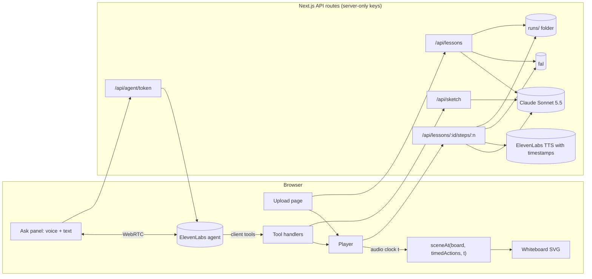
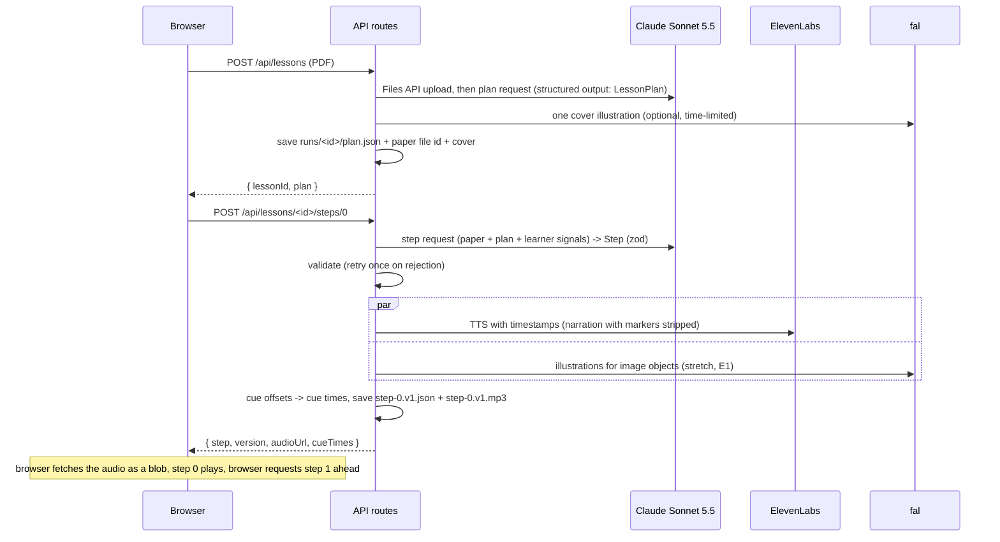
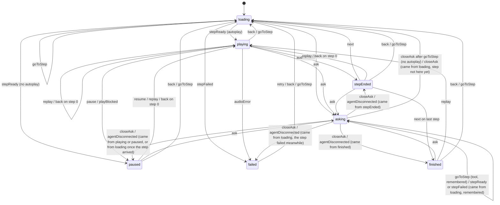
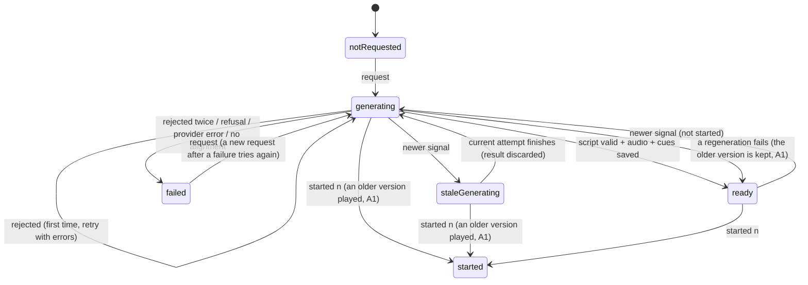

# Architecture

How the Visual-First AI Tutor runs, end to end. [`PROJECT_BRIEF.md`](../PROJECT_BRIEF.md) says **what** we're building and why. This file says **how**. [`ROADMAP.md`](ROADMAP.md) says **in what order**, and how each piece is proven to work.

Any change to a decision, a contract or a state machine in this file goes in the same PR as the code, and gets posted on the board.

## 1. Decisions

| Decision | Choice | Why |
|---|---|---|
| App | One **Next.js 16.4 (App Router) + TypeScript** app, on **Node 22** (pinned in `.nvmrc`, matching the laptops). The API routes are the backend. `cacheComponents` is off (create-next-app turns it on; we don't use it), and `next.config` sets `agentRules: false` so `next dev` doesn't rewrite `AGENTS.md`. | One language. The scene contract is written once and imported by both sides. |
| Runs on | **A local laptop**, as a production build (`npm run build && npm start`). | No serverless time limits on long generations. Local disk is the store. |
| Lesson LLM | **Claude Sonnet 5.5** (`claude-sonnet-5-5`) for the plan and every step. | Fast enough for live step generation. Set once in `lib/config.ts`. |
| Voice | **ElevenLabs** TTS with timestamps for narration. An **ElevenLabs agent** for Q&A, using the same voice. | Word-level timing for the lesson, and an interruptible agent for questions. |
| Q&A agent LLM | **Picked by spike S2**: two fast options from ElevenLabs' list, compared on the same questions. | It must answer in about a second and call tools reliably. |
| Agent config | **In the repo** (`agent/`), pushed to ElevenLabs with the official ElevenLabs CLI. | Prompts and tool definitions are reviewed in PRs and can't drift from the browser handlers. |
| Asking a question | **Voice or a typed message**, sent to the same agent. | A loud venue can break voice, so typing is the fallback. |
| Media | **fal**, server-side only. One cover illustration per lesson plan (M3), and illustrations on the whiteboard as stretch (E1). Optional: without `FAL_KEY`, images are hidden. | Precise diagrams are drawn by code. fal adds imagery. The budget is about 25 US dollars of fal credits per teammate, so generations are capped and cached. |
| Avatar | **None** (Anam dropped). | Removes the access risk. The bounties are Track 03 main, ElevenLabs and fal. |
| Generation | **Fully live**, with step N+1 generated while step N plays. Every run is saved to `runs/` and can be replayed offline. | Live by default, with a safety net if the network fails during judging. |
| Storage | **No database.** The `runs/<lessonId>/` folder is both the store and the replay set. | Fewer moving parts. |
| Papers | ***Attention Is All You Need*** is the **demo** paper. A second, different paper (non-ML or math-heavy, picked in spike S3) checks that the pipeline generalises. | Attention is very visual for the demo: matrix multiplication → dot-product attention → multi-head. But the product works for any paper: no paper-specific logic or concept lists in code or prompts. |
| Screen | **Desktop width, light theme** for the demo. | It's demoed on a laptop. Mobile and dark mode are out of scope. |

## 2. System overview



The app has two modes, kept separate on purpose:

- **Lesson mode, timed exactly.** Each scripted step is narration plus visual actions tied to words. Everything on the board follows the audio clock.
- **Q&A mode, loosely timed.** The learner interrupts and the voice agent answers. Its tools draw or highlight as it speaks, with no word-level timing.

Both modes draw through the same renderer, from the same scene contract.

## 3. Repo layout

```
app/
  page.tsx                          upload page
  lesson/[lessonId]/page.tsx        player page
  api/lessons/route.ts              POST: PDF -> lesson plan
  api/lessons/[lessonId]/steps/[n]/route.ts   POST: generate step n (script + audio + cue times), or return it if it's ready; after a failure, a new POST tries again (section 6.2)
  api/sketch/route.ts               POST: Q&A drawing request -> sketch
  api/lessons/[lessonId]/signals/route.ts     POST: record a learner signal or "step n started" (section 5.4)
  api/runs/[lessonId]/[file]/route.ts         GET: serve step JSON, audio and media from runs/ (no path traversal)
  api/agent/token/route.ts          GET: ElevenLabs conversation token
  dev/board/page.tsx                dev only: renders a fixed BoardState, or demo-m1 at ?t= via sceneAt (renderer tests); 404 in production unless FAKE_APIS=1
instrumentation.ts                  register(): validates env once at server start (not at build)
shared/                             imported by server and browser (the contract)
  scene.ts                          zod schemas: board objects, actions, step, sketch, board state
  lesson.ts                         zod schemas: lesson plan, API responses
  validate.ts                       checks that zod can't express (ids, cues, bounds)
  tools.ts                          the client tool names and parameter schemas (one list for the agent config and qa/tools.ts)
lib/                                server-only (import "server-only")
  config.ts                         model ids, effort, limits, paths: one place
  env.ts                            reads and validates env vars once
  pipeline/plan.ts, step.ts, sketch.ts, prompts/
  narration/cues.ts                 pure: strip markers, cue offsets -> times
  narration/tts.ts                  ElevenLabs TTS with timestamps
  media/fal.ts
  runs/store.ts                     read/write runs/<lessonId>/
  fakes/                            fake Claude/ElevenLabs/fal for tests (FAKE_APIS=1)
player/                             browser
  sceneAt.ts                        pure: board state at time t
  machine.ts                        pure: player state machine (section 6)
  Whiteboard.tsx, primitives/       matrix, text, latex, arrow, image
  usePlayer.ts                      audio element, clock, controls
qa/                                 browser
  conversation.ts                   adapter over @elevenlabs/react useConversation; a scripted fake when NEXT_PUBLIC_FAKE_APIS=1
  AskPanel.tsx                      voice + typed input, through conversation.ts
  tools.ts                          client tool handlers, typed by shared/tools.ts
scripts/                            dev scripts: make:m1, seed:m2
agent/                              ElevenLabs CLI config: the agent (prompt, voice, LLM) and its client tools, plus the CLI's tracking file
runs/                               gitignored: one folder per lesson (store + replay)
tests/e2e/                          Playwright, with FAKE_APIS=1 and NEXT_PUBLIC_FAKE_APIS=1
evidence/                           gitignored: screenshots and recordings for PRs
```

There are two ownership areas, and the folders of each are in the `AGENTS.md` §4 table:
- **A, browser:** the contract, the player and the Q&A browser side.
- **B, server:** the pipeline, the API routes (including `/api/sketch`), voice (`agent/`) and fal.

Task owners go on the GitHub issues. Files every task touches (`package.json`, `lib/config.ts`, `lib/env.ts`, `instrumentation.ts`, `.env.example`, `lib/fakes/`, `tests/e2e/`, `.github/`, `app/layout.tsx`) can be edited by anyone, with a post on the board.

## 4. The scene contract (`shared/scene.ts`)

This is the one contract between the step generator, the renderer and the Q&A tools. A change to it is posted on the board before it merges. The first version is deliberately small (what milestone M1 needs). New primitives get added only when a lesson needs them, and only as general primitives, never for one paper.

```ts
// Virtual canvas: every coordinate is in a 1600 x 900 viewBox, origin top-left.
// Matrix cells have a fixed size, CELL = 64 x 48 (w x h), so a board can be laid out without overlaps.
type ObjectId = string;                       // /^[a-z][a-z0-9_]{0,31}$/

type BoardObject = (                          // discriminated on `kind`
  | { kind: "matrix"; id; x; y; rows: string[][]; label?: string }   // 1..8 x 1..8 cells ("" is an empty cell); x,y is the top-left corner
  | { kind: "text";   id; x; y; text: string; size?: "s" | "m" | "l" }   // x,y is the centre of the text
  | { kind: "latex";  id; x; y; tex: string }                        // x,y is the centre
  | { kind: "arrow";  id; from: Anchor; to: Anchor; label?: string }
  | { kind: "image";  id; x; y; w; h; prompt: string }      // fal illustration, x,y top-left; the server adds mediaUrl
) & { hidden?: boolean };                     // true: not drawn until a `show` (default false)

type Target = { id: ObjectId; row?: number; col?: number };  // an object, or a row, column or cell of a matrix (0-based)
type Anchor = Target | { x: number; y: number };             // the centre of a target, or a point

type Action =
  | { do: "show" | "hide"; target: Target }
  | { do: "highlight" | "unhighlight"; target: Target; color?: "accent" | "warn" }
  | { do: "move"; target: Target; to: Anchor }               // the target's centre ends on the anchor
  | { do: "write"; target: Target; value: string };          // a matrix cell's value, or a text object's text
// Every action also carries durationMs (0..3000, default 400).

type Step = {                                 // what Claude writes for one lesson step
  title: string;
  narration: string;                          // with cue markers: "Take the first [[row1]]row..."
  objects: BoardObject[];                     // the board when the step starts
  actions: (Action & { cue: string })[];      // fired when the cue's word is spoken
};

type Sketch = {                               // what /api/sketch returns for a Q&A drawing
  objects: BoardObject[];                     // added to the current board, or to an empty one with fresh (section 8)
  actions: (Action & { atMs: number })[];     // fired at a time offset, no narration
};
```

- `mediaUrl` isn't part of the schema Claude fills in. The server adds it after fal returns and the image is saved to `runs/`. The page never loads a URL that a model wrote.
- When several actions start at the same time, `sceneAt` applies them in their array order.
- **Geometry.** Cell (r, c) of a matrix at x,y has its centre at (x + 64c + 32, y + 48r + 24). Brackets and the label are drawn outside that box. A whole matrix's centre is the centre of its cell box. The centre of a row or column is the centre of its cells, an arrow's is the midpoint of its ends, and an image's is the middle of its box. `CELL` is exported from `shared/scene.ts`, and the renderer and the prompts both use it.
- **Hidden objects.** An object with `hidden: true` is on the board from the start but isn't drawn until a `show`. That's how product terms and sums appear partway through a step.
- **Moving part of a matrix.** `move` on a whole object moves it. `move` on a row, column or cell slides a **copy** of those cells (same values and highlight), so the source matrix stays whole, with no gap. Each row, column or cell gets its own copy the first time it moves. After that, an anchor or a later `move` naming that part uses the copy, `hide` on the part removes the copy, and `highlight`, `unhighlight` and `write` change the source cells and the copy together. The source cells are never hidden on their own.
- **Arrows** are drawn between their anchors where they are now, so an arrow follows an object that moves. An arrow itself can't be moved.
- **Writing.** `write` replaces a matrix cell's value or a text object's text, so a text showing `1·5 + 2·7` can become `19` and then move into a cell.

**The M1 demo in this contract** (`lib/fakes/fixtures/demo-m1.step.json`, hand-written in F3 as the contract's acceptance test). Matrices `a` and `b` and an empty result `c` are visible; `p1` (`1·5`), `p2` (`2·7`) and `sum` are hidden `text` objects.
1. `[[row]]`: highlight row 0 of `a`. `[[col]]`: highlight column 0 of `b`. `[[slide]]`: two `move` actions on this one cue, row 0 of `a` (a copy) to a point left of `c` and column 0 of `b` (a copy) to a point beside it. The row and column slide together.
2. `[[pair1]]`, `[[pair2]]`: show `p1`, then `p2`. The pairs multiply.
3. `[[add]]`: show `sum` with `1·5 + 2·7`. `[[total]]`: write `19` to `sum`.
4. `[[drop]]`: move `sum` to `{ id: "c", row: 0, col: 0 }`. `[[done]]`: write `19` to that cell, hide `sum` and hide both copies. The sum has dropped into (1,1), the first cell.

**`shared/validate.ts`** checks the rules zod can't express. It runs on the server after Claude responds and in the browser before a tool draws. Each row gets a test.

| Input | Result |
|---|---|
| Every rule holds | valid |
| The output fails the zod schema (the SDK throws a parse error) | rejected: the schema error |
| A cue in `actions` doesn't appear in `narration` | rejected: `unknown cue "x"` |
| A marker appears twice in `narration` | rejected: `duplicate cue "x"` |
| A malformed marker (`[[Row 1]]`, a stray `[[` or `]]`) | rejected: `malformed marker "[[Row 1]]"` (otherwise it would be read aloud) |
| A marker in `narration` that no action uses | allowed (it's ignored) |
| A `target.id`, or an anchor's `id`, with no object | rejected: `unknown object "x"` |
| `row` or `col` outside the matrix, or set on a non-matrix (in a target or an anchor) | rejected: `target out of range` |
| `write` on a matrix without both `row` and `col` | rejected: `write needs a cell` |
| `write` on a `latex`, `arrow` or `image` | rejected: `can't write to "x"` |
| `show` with `row` or `col` | rejected: `show needs a whole object` |
| `move` on an `arrow` | rejected: `can't move "x"` |
| `show` on a visible object, `hide` on a hidden one, or `hide` on a part that hasn't moved | allowed (no change) |
| `tex` that KaTeX can't parse | rejected: `invalid LaTeX in "x"` (the renderer also uses `throwOnError: false` as a safety net) |
| An object, or an `{x, y}` point in an anchor, outside the 1600 × 900 canvas (for a matrix, its whole cell box; for `text` and `latex`, only their x,y) | rejected: `off canvas` |
| Two objects with the same id | rejected: `duplicate id "x"` |
| Narration longer than `config.maxNarrationChars` after the markers are stripped | rejected: `narration too long` |
| Narration with nothing left after the markers are stripped (only markers or spaces) | rejected: `narration empty` (TTS would fail after validation, too late to retry) |
| An arrow end that names an arrow (itself, or arrows anchored to each other) | rejected: `can't anchor to "x"` (an arrow's centre is the midpoint of its ends, so it would have no position) |
| A sketch action or anchor uses an id from the board the sketch draws on | valid |
| The same, with `fresh: true` (the board is empty) | rejected: `unknown object "x"` |
| A sketch object reuses an id from the board it draws on | rejected: `duplicate id "x"` |

For a sketch, the known ids are its own objects plus those of the board it draws on (section 8).

When generation is rejected (a zod parse error or a `validate.ts` rejection), the generator retries **once**, with the error messages added to the prompt. If the retry also fails, the step fails (section 6.2).

## 5. Lesson mode

### 5.1 Making a lesson



- **The paper goes to Claude directly.**
  - It's uploaded once with the Files API (`client.files.upload`).
  - Every plan and step request then references it by `file_id`, as a `document` block.
  - The upload size cap (`config.maxPdfMb`) is our own choice, not Claude's limit. We don't parse the PDF ourselves: when Claude rejects it (too many pages, encrypted, unreadable), we return the upload error in section 7.
- **Caching.** The document block carries `cache_control: { type: "ephemeral", ttl: "1h" }`, so later step requests reuse the cached paper. The 1-hour cache outlasts long Q&A pauses and rehearsals. Its writes cost more than the 5-minute cache's, but each request type writes the paper only once. For the cache to work:
  - The step system prompt must be byte-identical for every step.
  - The plan, goal, signals and (for a sketch) the current board go *after* the document block.
  - The plan and sketch requests use a different output format, so they build their own cache.
- **Structured output.** Requests stream: `client.messages.stream({ output_config: { format: zodOutputFormat(Step) } })` (the helper is in `@anthropic-ai/sdk/helpers/zod`), then `(await stream.finalMessage()).parsed_output`.
  - Constraints the API can't enforce (number ranges, item counts) are checked by the SDK with zod after the response arrives, and a failure *throws*. The generator catches it as a rejection.
  - Effort per request type (plan, step, sketch) is set in `lib/config.ts`.
- **Prompts are generic.** No paper-specific logic, hard-coded concept lists or examples taken from the demo paper, in prompts or code. Paper-specific content lives only in fixtures and demo checks.
- **Prompts** live in `lib/pipeline/prompts/`. A step prompt receives:
  - the plan and the step's goal
  - the previous step's narration if it has been generated, otherwise that step's goal from the plan (needed after a jump)
  - the learner signals (section 5.4)
- **Cover illustration (fal).** The plan includes a `coverPrompt`. After the plan is saved, the server asks fal for **one** image and saves it in the run folder, recording its file name as `cover` in `plan.json` and in the plan response. The upload page's plan view shows it, and the lesson page shows it as a header.
  - It sits outside the scene contract and `sceneAt`: it's page chrome, not a board object.
  - The plan route waits for it up to `config.coverTimeoutMs`. If fal is slow, fails or has no `FAL_KEY`, the plan is returned and saved without `cover`, and the pages show no image. The timeout is kept to a few seconds, since step 0 is requested after the plan returns.
  - Budget: about 25 US dollars of fal credits per teammate. So it's one image per lesson plan, a saved cover is never regenerated, replay never calls fal, and tests use the fal fake.
- **Files reach the browser through `GET /api/runs/<lessonId>/<file>`.** `runs/` is outside `public/`, and `next start` won't serve files added after the build.
  - The player fetches each step's audio as a blob and plays it from a `blob:` URL. That keeps seeking reliable without HTTP Range support in the route.
  - The route only serves names matching `^[a-z0-9.-]+$` from inside the run folder.

### 5.2 Cue markers become times (`lib/narration/cues.ts`, pure)

1. The markers match `\[\[([a-z][a-z0-9_]{0,31})\]\]`. Stripping them, trimming the text and collapsing whitespace gives the text sent to TTS, plus a map from each cue to the character offset where its marker was.
2. ElevenLabs `POST /v1/text-to-speech/{voice_id}/with-timestamps` returns `audio_base64` and `alignment`, with `characters`, `character_start_times_seconds` and `character_end_times_seconds`.
3. The offsets → times map is built by **walking `alignment.characters` against the text we sent**, rather than assuming the arrays line up index for index. ElevenLabs may count characters differently from JavaScript (code points vs UTF-16).
4. Each cue's time is the start of the first non-space character at or after its offset. A cue at the very end gets the last character's end time.

| Input | Result |
|---|---|
| No markers | the text unchanged, no cues |
| A marker mid-word (`ro[[c]]w`) | its time is the start of `w` |
| Two markers back to back | both get the same time |
| A marker at the end | the last character's end time |
| Unicode (é, emoji, CJK) in the narration | the walk matches characters one by one, so the cues still land correctly |
| The alignment skips or adds characters (normalisation) | the walk resyncs on the next matching character, and the cue takes the nearest following time |
| `alignment` is null, or the walk can't match at all | error `no alignment`: the step fails (section 6.2), logged with the text and response |

Property-based tests (fast-check) check three things:
- stripping then reinserting the markers gives back the original text
- cue times never decrease in text order
- walking an alignment generated from the text itself gives exact times

### 5.3 The player is a function of time (`player/sceneAt.ts`, pure)

```ts
sceneAt(objects: BoardObject[], timed: { action; startMs; durationMs }[], tMs: number): BoardState
```

- `BoardState` (a zod schema in `shared/scene.ts`, since `/api/sketch` receives it) is every object with its visibility, highlight, position and value at `tMs`, plus the moved copies of matrix parts. For each action in progress, it also includes how far along it is (0..1).
- **Lesson mode:** `timed` comes from `cueTimes`, and `tMs` is `audio.currentTime * 1000`.
- **Q&A mode:** the lesson board stays at `pausedT`, with the Q&A drawing on top (section 8). `objects` is the step's objects plus each sketch's objects. `timed` is the step's actions that started by `pausedT`, plus each Q&A action at `pausedT` + the time since Ask opened when it arrived (+ `atMs` for a sketch). `tMs` is `pausedT` + the time since Ask opened. After a `fresh` sketch, the step and earlier sketches are left out.
- **Timing rules** (what `sceneAt` does with each action):
  - Actions apply in start order. Actions that start at the same time apply in their array order.
  - `show`, `highlight`, `unhighlight` and `write` take effect when they start. `hide` takes effect when it ends, so the renderer can fade it out using progress.
  - `move` slides in a straight line from where its target was when the move started to where its anchor was then. Its path doesn't change if the anchor moves later.
  - An action is in `active` while `startMs <= tMs < startMs + durationMs`. A 0 ms action is complete at its start and never active.
  - An action that, once complete, would leave the board as it was when it started is never in `active`: for example a `show` of a visible object, a `highlight` in the colour its cells already have, or a `write` of the value already there. So the renderer never fades in what is already on the board.
  - `unhighlight` with a `color` clears only that colour. Without one, it clears every colour.
  - A whole-matrix highlight sets every cell in `cellHighlight`. A matrix's own `highlight` stays `null`.
  - Actions on unknown or out-of-range targets are ignored and never listed in `active`. `validate.ts` rejects them first.
  - When a `hide` on a moved part ends, its copy leaves `copies`. Anchors naming that part then resolve to the source cells, and a later `move` of it makes a fresh copy.
  - A copy is independent of its matrix once made: hiding or moving the whole matrix leaves its copies where they are.
  - `player/sceneAt.ts` also exports `timeline(actions, cueTimes)`, which builds `timed` in lesson mode, and `resolveAnchor(board, anchor)`, which gives the renderer arrow ends.
- Back, Replay and scrubbing are just seeks on the audio element. There's no animation state to undo.
- `Whiteboard.tsx` renders `BoardState` as SVG on each animation frame. It interpolates from each action's progress, and exposes state as `data-*` attributes for tests.
- Motion is only used for UI chrome, such as panels and buttons, not for board objects, so the board always matches the clock.

### 5.4 Adaptation

- **Recording signals.** The browser posts to `POST /api/lessons/<id>/signals`. The body is validated with zod and holds one of:
  - a question: the agent's user transcript (from `onMessage`) or typed text
  - a simplify request from `simplify_upcoming`
  - `{ started: n, version: k }` when version k of step n starts playing

  The server appends it to `runs/<id>/signals.json` and bumps the lesson's **signals version**.
- Every step generation records the signals version it used.
- When a question or simplify signal arrives, any step that **hasn't started playing** is out of date if it was generated (or is still generating) with an older version:
  - The server marks it stale and regenerates it as soon as the current generation finishes (section 6.2).
  - The browser keeps its prefetched copy of N+1 and requests the step again. When Next is pressed, it plays the new version if it has arrived, and otherwise the copy it already has, so Next never waits for a regeneration.
- A step that has started playing is kept as it is. A regeneration still running for it is discarded when it finishes.
- A regeneration that fails keeps the older version: the step stays playable.

### 5.5 Replay safety net

- Everything generated is written to `runs/<lessonId>/`: `plan.json`, the cover, `step-<n>.v<k>.json`, the audio, cue times and media for each step, and `signals.json`.
- Steps are **versioned** (`v1`, `v2`, ...) because a signal can regenerate one. `signals.json` records which version of each step started playing.
- Starting the app with `REPLAY_RUN=<lessonId>`:
  - The upload page redirects to `/lesson/<lessonId>`.
  - The routes serve each step's *played* version, or its latest version if it never played, from the folder. They never call Claude, ElevenLabs or fal.
  - A step that isn't in the folder fails, with "This step isn't in the saved run."
- Q&A needs the network, so in replay mode the Ask panel says "Q&A needs a connection".

## 6. State machines

### 6.1 Player (`player/machine.ts`, pure)



`loading` carries the step it's loading and whether to **autoplay**: yes for Next, Back and goToStep; no after a Q&A jump. `stepReady(i)` and `stepFailed(i)` carry their step index. Entering `loading` requests the step, so Retry from `failed` is just a new request: the server returns the saved step, or generates it again if it failed (section 6.2). An event for a step other than the one being loaded is a late reply to an earlier request: it's ignored and logged. Ask can open while a step loads (a step that wasn't prefetched can take a while, which is when the learner wants to ask). The step keeps loading, and the result is remembered for when Ask closes.

Every state × event pair has a defined result, and each cell gets a test:
- **ignored** means the state doesn't change and nothing is shown.
- **rejected** means the state doesn't change and the learner is told why.
- **can't happen** gives the reason. The machine still treats these as ignored, and logs a warning.

| State \ event | stepReady(i) / stepFailed(i) | audioEnded | playBlocked | audioError | pause | resume | replay | ask | closeAsk | agentDisconnected | next | back | goToStep(n) | retry |
|---|---|---|---|---|---|---|---|---|---|---|---|---|---|---|
| loading(k) | i = k: → playing (autoplay) or paused, or → failed with the server's message ("Couldn't make this step. Retry?", or in replay "This step isn't in the saved run."). i ≠ k: ignored (late reply) | can't happen (no audio) | can't happen | can't happen | ignored | ignored | ignored | → asking (remembers loading(k); the step keeps loading) | can't happen (not asking) | can't happen | ignored | ignored | → loading(n) | ignored |
| playing | ignored (late reply) | → stepEnded | → paused, with "Press play to start" | → failed ("Couldn't play the audio. Retry?") | → paused | ignored | seek to 0, stays playing | → asking (narration paused) | can't happen | can't happen | ignored (Next only after the step ends) | → loading(prev), or seek to 0 on step 0 | → loading(n) | ignored |
| paused | ignored (late reply) | can't happen (audio stopped) | can't happen | ignored | ignored | → playing | seek to 0 → playing | → asking | can't happen | can't happen | ignored | → loading(prev), or seek to 0 → playing on step 0 | → loading(n) | ignored |
| stepEnded | ignored (late reply) | can't happen | can't happen | ignored | ignored | ignored | seek to 0 → playing | → asking | can't happen | can't happen | → loading(next), or → finished on the last step | → loading(prev), or seek to 0 → playing on step 0 | → loading(n) | ignored |
| asking | Ask opened from loading(k) and i = k: remembered for closeAsk. Otherwise ignored (late reply) | can't happen (narration paused) | can't happen | ignored | ignored | ignored | ignored | ignored | → the state Ask was opened from (playing becomes paused; loading(k) becomes paused, or failed with the server's message, if step k's result arrived meanwhile, and otherwise stays loading(k)), or → loading(n, no autoplay) if the agent called goToStep(n). The Q&A drawing is discarded and the board is `sceneAt(step, pausedT)` again (or the arrived step at 0, from loading) | same as closeAsk, plus "Q&A ended unexpectedly." | ignored | ignored | stays asking, remembers n (agent tool) | ignored |
| failed | ignored (late reply) | can't happen | can't happen | can't happen | ignored | ignored | ignored | rejected: nothing to ask about | can't happen | can't happen | ignored | → loading(prev), or ignored on step 0 | → loading(n) | → loading(same) |
| finished | ignored (late reply) | can't happen | can't happen | ignored | ignored | ignored | seek to 0 → playing | → asking | can't happen | can't happen | ignored | → loading(last) | → loading(n) | ignored |

- `goToStep(n)` with `n` outside the plan is **rejected** in every state: the agent tool returns `"no step n"` and the state doesn't change.
- When the agent jumps steps during Q&A, it finishes speaking. The new step loads paused once Ask closes, so the narration never talks over the agent.
- `playBlocked` is the browser refusing `audio.play()` without a user gesture, for example after a page reload.

### 6.2 Step generation (per step, on the server)



| State \ event | request | rejected (zod or validate) | valid + audio + cues | refusal / Claude error after SDK retries / `max_tokens` cut-off | TTS or quota error, no alignment | newer signal (A1) | started n (A1) |
|---|---|---|---|---|---|---|---|
| notRequested | → generating | can't happen | can't happen | can't happen | can't happen | ignored (generates with the new version later) | can't happen (not served) |
| generating | waits for this generation (no second one) | first time: retry with errors; second time: → failed, or → ready with the older version if this is a regeneration (A1) | → ready | → failed, or → ready with the older version if this is a regeneration (A1) | → failed, or → ready with the older version if this is a regeneration (A1) | → staleGenerating | → started if an older version played (the browser didn't wait for this one); the running attempt is discarded when it finishes. On a first generation, can't happen (nothing served) |
| staleGenerating | waits | discarded → generating | discarded → generating | → generating (new version) | → generating (new version) | stays (the latest version is used) | → started, as in generating |
| ready | returns it from `runs/` | can't happen | can't happen | can't happen | can't happen | → generating (new version) | → started |
| started | returns the played version | discarded: an attempt still running when an older version started (A1) | discarded (A1) | discarded (A1) | discarded (A1) | ignored (already heard) | ignored |
| failed | → generating: a new request after a failure tries again (this is how the player's Retry works) | can't happen | can't happen | can't happen | can't happen | ignored | can't happen (not served) |

The two columns marked (A1), and the cells marked A1, can only happen once adaptation (A1) is built: A1 tests those, and G2 tests the rest. A fal error doesn't fail the step: the image object is hidden (section 7). In replay mode this machine doesn't run: a step missing from the folder fails on every request, with "This step isn't in the saved run." (section 5.5).

## 7. Errors and rejections

The developer gets the full error in the server log, tagged with the route, lesson and step. The learner gets plain words and a way to recover.

| Where | Problem | Learner sees | Recovery |
|---|---|---|---|
| Upload | No file, or not a PDF | "Please choose a PDF." | Pick again |
| Upload | Over `config.maxPdfMb`, or Claude rejects the document (too many pages, encrypted, unreadable) | "This PDF is too large or locked." | Another PDF |
| Plan | Invalid plan twice, refusal, or Claude error | "Couldn't read this paper." | Retry, or another PDF |
| Step | Any `failed` cause in section 6.2 | "Couldn't make this step." | Retry (player `failed` state) |
| Step | Replay mode, and the step isn't in the run | "This step isn't in the saved run." | Back, or another step |
| Plan or step | fal error or timeout, or no `FAL_KEY` | Nothing: the plan or step shows without the illustration | The image is hidden and the error is logged |
| Player | Browser blocks autoplay | "Press play to start." | Play button |
| Player | Audio fails to load or decode | "Couldn't play the audio. Retry?" | Retry |
| Route | `lessonId` doesn't match `^[a-z0-9-]{1,40}$`, or `n` isn't a step in the plan | 400 "No such lesson or step." | Back to upload |
| Ask | Token route fails, or the agent can't connect | "Questions are unavailable right now." | The lesson carries on; close the panel |
| Ask | Session drops mid-question | "Q&A ended unexpectedly." | Ask again |
| Ask | Microphone permission denied | "Mic is off. Type your question; the answer will appear as text." | Typed input (text-only session) |
| Tool | `draw_scene` sketch invalid, or the sketch request fails | The Ask panel shows "Couldn't draw that." The agent is told through `sendContextualUpdate()` (it doesn't wait for a result, section 8) | The agent answers in words |
| Tool | `highlight` on an unknown id | Agent told `unknown object "x"` | None needed |
| Server start | Missing required env var for the mode (section 9) | The server refuses to start and names the missing var | Fix `.env.local` |

## 8. Q&A mode

- **Starting a session:** the learner presses **Ask**, or presses the `A` key (Space stays play/pause).
  1. The player moves to `asking` and pauses the narration. Ask also works while a step is loading (section 6.1).
  2. The browser calls `GET /api/agent/token`, and the server gets a WebRTC conversation token with `ELEVENLABS_API_KEY`.
  3. `startSession({ conversationToken })` starts the session through `qa/conversation.ts`.
     - That adapter is the only file that imports `@elevenlabs/react`, which also needs a `ConversationProvider` around the lesson page.
     - With `NEXT_PUBLIC_FAKE_APIS=1` the adapter is a scripted fake: it replays canned agent turns and calls the tool handlers directly, so Playwright can test Q&A without a network.
- **Typed questions** go through `sendUserMessage(text)` to the same agent.
  - While the learner types, the mic is muted so venue noise doesn't start a turn, and `sendUserActivity()` keeps the agent from talking over them.
  - If mic permission is denied, the session starts text-only and answers appear as text. Spike S2 confirms that text-only answers aren't spoken.
- **Context:** when the session connects, and on every step change, the browser calls `sendContextualUpdate()`. It sends:
  - the plan titles
  - the current step's narration up to the point where it was paused (or, while a step is loading, that step's goal from the plan)
  - the ids of the objects on the board
  - the questions asked earlier in this lesson

  So the agent knows what "this" means and which ids `highlight` can use. The browser also sends one when a `draw_scene` sketch fails, so the agent answers in words.
- **Client tools.** Names and parameters are in `shared/tools.ts`. The agent config and `qa/tools.ts` both use that list, and a test checks they match.

| Tool | Parameters | Waits for result? | Effect | Returns to the agent |
|---|---|---|---|---|
| `highlight` | `target_id`, `row?`, `col?` | yes | Highlights part of the current board | `"ok"`, or the validation error |
| `go_to_step` | `step` (1-based, as spoken) | yes | `goToStep(step - 1)`, which loads once Ask closes | `"ok"`, or `"no step n"` |
| `draw_scene` | `description` (plain words), `fresh?` (default false) | **no** | Browser → `POST /api/sketch` (low effort) with the current board → `Sketch` → validated → drawn on top of the current board when it arrives, or on an empty board with `fresh: true` | nothing, so the agent keeps talking while the sketch is made |
| `simplify_upcoming` | `reason` | no | Posts a signal (section 5.4) | nothing |

- `draw_scene` doesn't wait, because a Claude request can't finish inside a natural pause. The agent's prompt tells it to describe the sketch out loud while it appears. A failed sketch is logged, the Ask panel shows "Couldn't draw that", and the browser tells the agent through `sendContextualUpdate()` so it answers in words (section 7). Spike S2 measures the sketch's latency.
- `draw_scene` takes plain words, not scene JSON. The voice model only describes what to draw, and Claude writes the validated sketch, so the scene schema stays in one place and out of the agent's prompt.
- **A sketch builds on the board the learner is looking at.** The request body is `{ description, fresh, board }`, where `board` is the current `BoardState`. The route checks the body with zod, including a cap on the board's size (`config.maxBoardObjects`). Claude sees the board, so an answer to "why does the row go with the column?" can highlight and draw over the matrix on screen.
  - The sketch's ids are checked against its own objects plus the board's (section 4). With `fresh: true` the sketch starts from an empty board, and later sketches in this Ask build on that new board, not the lesson board.
  - The browser validates the sketch again against the board it has when the sketch arrives, since the board may have changed while Claude worked.
- **The board during Ask.** Ask freezes the lesson board at `pausedT`: the audio time when Ask opened, the end of the step from `stepEnded` or `finished`, or an empty board from `loading`. `highlight` and sketches draw on top of it, each timed from when it arrives. **Closing Ask throws all of that away**: the board goes back to `sceneAt(step, pausedT)` and the player returns to the state Ask was opened from, with `playing` becoming `paused` (section 6.1), so Play carries on from the same point. If Ask was opened while loading and the step arrived meanwhile, the board is that step at 0.
- **Agent config in the repo.** We use the official **ElevenLabs CLI** (`@elevenlabs/cli`) rather than writing our own sync script.
  - The agent and its client tools are config files in `agent/`, pushed with the CLI's agent and tool `push` commands.
  - The CLI tracks the agent's id. Its tracking file is committed, so the team shares **one** agent.
  - Only the owner of `agent/` (`AGENTS.md` §4) runs `push`.
  - Spike S5 confirms the exact commands and that client tools with `expects_response` work this way.
- **One voice.** `ELEVENLABS_VOICE_ID` is the source. The agent config uses the same id, and a unit test checks they're equal.

## 9. Configuration and secrets

`.env.local` is gitignored. `.env.example` is committed, with every key listed but no values.

| Variable | Used by |
|---|---|
| `ANTHROPIC_API_KEY` | lesson, step and sketch routes |
| `ELEVENLABS_API_KEY` | TTS, the token route, the ElevenLabs CLI |
| `ELEVENLABS_VOICE_ID` | narration and the agent (one voice) |
| `ELEVENLABS_AGENT_ID` | the token route (from the CLI's tracking file) |
| `FAL_KEY` | `lib/media/fal.ts` (optional: without it, every image is hidden) |
| `FAKE_APIS` | `1` swaps all three providers for `lib/fakes/` (tests and CI), and lets a production server serve the dev-only `/dev/board` |
| `NEXT_PUBLIC_FAKE_APIS` | `1` swaps the browser's agent conversation for the scripted fake. It's inlined at build time, so CI builds with it set. |
| `REPLAY_RUN` | serve a saved run from `runs/` |

**Required keys depend on how the app runs.** Each row gets a test:

| Mode | Required | Not required |
|---|---|---|
| Real (`npm start`) | `ANTHROPIC_API_KEY`, `ELEVENLABS_API_KEY`, `ELEVENLABS_VOICE_ID` | `ELEVENLABS_AGENT_ID` (only the token route needs it; without it, Ask shows "Questions are unavailable right now."). `FAL_KEY` (without it, no images: fal can never stop the server from starting) |
| `FAKE_APIS=1` (tests, CI) | none | all keys |
| `REPLAY_RUN=<id>` | the run folder exists | all keys (Q&A is off) |
| `next build` | none: env isn't checked at build | all keys |

- `lib/env.ts` validates the env once, at server start, from `instrumentation.ts` `register()`, with zod. Code behind it trusts the values. A missing required key stops the server, and the error names the key.
- Keys are only read in `lib/` and the API routes, which import `"server-only"`. The browser never sees a key.
- All of these live in `lib/config.ts`: model ids, effort per request type, `maxNarrationChars`, `maxPdfMb`, `coverTimeoutMs`, `maxBoardObjects` (the cap on the board a sketch request sends, section 8), the image cap per lesson (E1) and the `runs/` path.

## 10. Testing: how we prove it works

| Layer | Tool | What it covers | Paid APIs? |
|---|---|---|---|
| Unit | Vitest | Pure logic: `cues.ts`, `sceneAt.ts`, `machine.ts` (one test per cell of §6.1), `validate.ts` (one per row of §4), the step-generation rules (one per cell of §6.2), env modes (one per row of §9) | Never |
| Property | fast-check (in Vitest) | Cue strip/reinsert round trip, cue times never decrease, alignment walk, `sceneAt` deterministic under seeking | Never |
| Route | Vitest + `lib/fakes/` | Each API route with faked Claude/ElevenLabs/fal: success, every rejection in section 7, retry once, replay mode | Never |
| End to end | Playwright, `FAKE_APIS=1` + `NEXT_PUBLIC_FAKE_APIS=1` | Upload → plan → step plays → highlight at its cue → Next → Ask (typed) → `draw_scene` on the current board → close Ask, board restored. Tests assert on `data-*` attributes, and check timing by seeking to the cue time, never by waiting | Never |
| Real run | Agent-driven browser, real APIs | The feature working for real in a browser on the laptop. The PR lists what was checked, with screenshots or a short recording. | Yes, by hand, never in CI |

- **Fakes** return recorded fixtures from `lib/fakes/fixtures/`. These are real responses captured once, with secrets removed, so tests check against real response shapes without paying for them. A task that adds a provider call also commits its fixture.
- **CI** is GitHub Actions on every PR: `npm ci`, `lint`, `typecheck`, `test`, `build` and `e2e` (with fakes). It must be green to merge.
- What every PR has to show is the definition of done in [`ROADMAP.md`](ROADMAP.md#definition-of-done).

## 11. Open questions and spikes

Each spike is time-boxed to 60 minutes, and its answer is written back into this file:

- **S1:** the exact shape of ElevenLabs' timestamps for our narration (how characters are counted, normalisation, whether `alignment` can be null), and latency per step.
- **S2:** the Q&A agent's LLM, comparing two candidates on latency and tool-calling. Also: whether text-only sessions speak, and how long a `draw_scene` sketch takes.
- **S3:** whether Sonnet 5.5 writes valid, good `Step` scripts from the Attention paper and from a second, different paper (non-ML or math-heavy), and the effort level needed for steps, plans and sketches.
- **S4:** which fal image model to use for the cover (M3) and for in-scene images (E1, stretch), and its latency. Download the images into `runs/`, in case fal's URLs expire. Keep the generations few: the budget is about 25 US dollars per teammate.
- **S5:** the ElevenLabs CLI commands that push the agent and its client tools from `agent/`, and how its tracking file records the agent id.

## Sources

- ElevenLabs: [React SDK](https://elevenlabs.io/docs/eleven-agents/libraries/react), [client tools](https://elevenlabs.io/docs/eleven-agents/customization/tools/client-tools), [TTS with timestamps](https://elevenlabs.io/docs/api-reference/text-to-speech/convert-with-timestamps), [CLI](https://elevenlabs.io/docs/eleven-agents/operate/cli.md)
- Anthropic: [PDF support](https://platform.claude.com/docs/en/build-with-claude/pdf-support.md), [structured outputs](https://platform.claude.com/docs/en/build-with-claude/structured-outputs.md), [TS SDK helpers](https://raw.githubusercontent.com/anthropics/anthropic-sdk-typescript/main/helpers.md)
- fal: [JavaScript client](https://fal.ai/docs/model-apis/clients/javascript), [server-side usage](https://fal.ai/docs/model-apis/model-endpoints/server-side)
