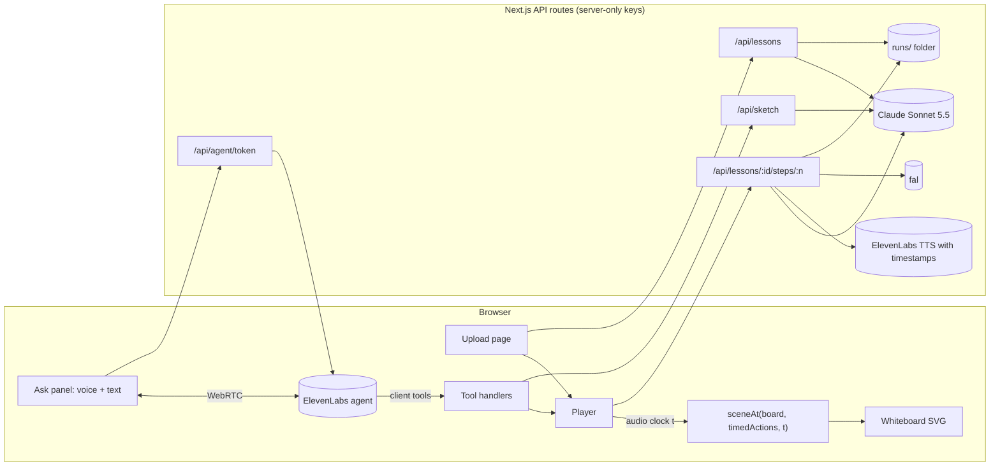
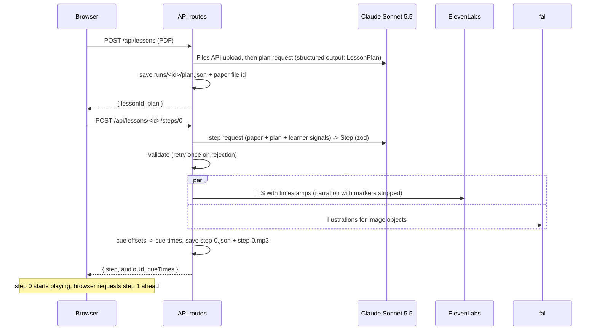
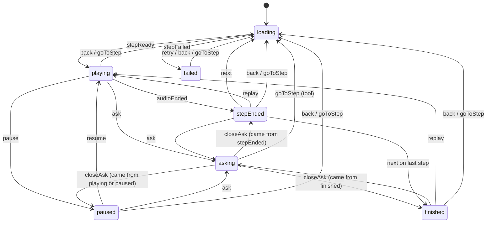
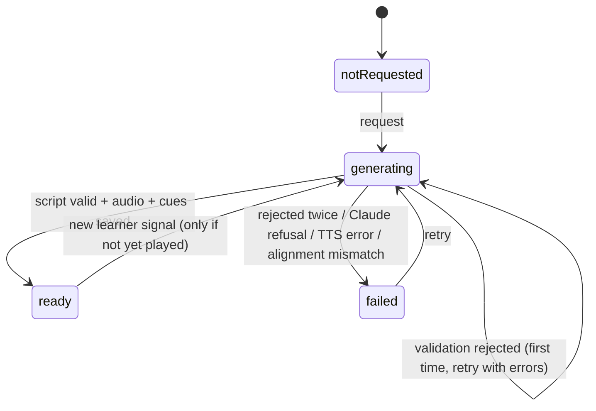

# Architecture

How the Visual-First AI Tutor runs, end to end. [`PROJECT_BRIEF.md`](../PROJECT_BRIEF.md) says **what** we're building and why. This file says **how**. [`ROADMAP.md`](ROADMAP.md) says **in what order**, and how each piece is proven to work.

Any change to a decision, a contract or a state machine in this file goes in the same PR as the code, and gets posted on the board.

## 1. Decisions

| Decision | Choice | Why |
|---|---|---|
| App | One **Next.js 16 (App Router) + TypeScript** app. The API routes are the backend. | One language. The scene contract is written once and imported by both sides. |
| Runs on | **A local laptop**, as a production build (`npm run build && npm start`). | No serverless time limits on long generations. Local disk is the store. |
| Lesson LLM | **Claude Sonnet 5.5** (`claude-sonnet-5-5`) for the plan and every step. | Fast enough for live step generation. Set once in `lib/config.ts`. |
| Voice | **ElevenLabs** TTS with timestamps for narration. An **ElevenLabs agent** for Q&A, using the same voice. | Word-level timing for the lesson, and an interruptible agent for questions. |
| Q&A agent LLM | **Picked by spike S2**: two fast options from ElevenLabs' list, compared on the same questions. | It must answer in about a second and call tools reliably. |
| Agent config | **In the repo** (`agent/`), pushed to ElevenLabs by a script. | Prompts and tool definitions are reviewed in PRs and can't drift from the browser handlers. |
| Asking a question | **Voice or a typed message**, sent to the same agent. | A loud venue can break voice, so typing is the fallback. |
| Media | **fal**, server-side only, for illustrations next to the whiteboard. | Precise diagrams are drawn by code. fal adds imagery. |
| Avatar | **None** (Anam dropped). | Removes the access risk. The bounties are Track 03 main, ElevenLabs and fal. |
| Generation | **Fully live**, with step N+1 generated while step N plays. Every run is saved to `runs/` and can be replayed offline. | Live by default, with a safety net if the network fails during judging. |
| Storage | **No database.** The `runs/<lessonId>/` folder is both the store and the replay set. | Fewer moving parts. |
| Demo paper | ***Attention Is All You Need***. | Matrix multiplication → dot-product attention → multi-head. Very visual. |
| Screen | **Desktop width, light theme** for the demo. | It's demoed on a laptop. Mobile and dark mode are out of scope. |

## 2. System overview



The app has two modes, kept separate on purpose:

- **Lesson mode, timed exactly.** Each scripted step is narration plus visual actions tied to words. Everything on the board follows the audio clock.
- **Q&A mode, loosely timed.** The learner interrupts and the voice agent answers. Its tools draw or highlight as it speaks, with no word-level timing.

Both modes draw through the same renderer, from the same scene contract.

## 3. Repo layout

```
app/
  page.tsx                          upload page
  lesson/[lessonId]/page.tsx        player page
  api/lessons/route.ts              POST: PDF -> lesson plan
  api/lessons/[lessonId]/steps/[n]/route.ts   POST: generate step n (script + audio + cue times)
  api/sketch/route.ts               POST: Q&A drawing request -> sketch
  api/agent/token/route.ts          GET: ElevenLabs conversation token
shared/                             imported by server and browser (the contract)
  scene.ts                          zod schemas: board objects, actions, step, sketch
  lesson.ts                         zod schemas: lesson plan, API responses
  validate.ts                       checks that zod can't express (ids, cues, bounds)
lib/                                server-only (import "server-only")
  config.ts                         model ids, effort, limits, paths: one place
  env.ts                            reads and validates env vars once
  pipeline/plan.ts, step.ts, sketch.ts, prompts/
  narration/cues.ts                 pure: strip markers, cue offsets -> times
  narration/tts.ts                  ElevenLabs TTS with timestamps
  media/fal.ts
  runs/store.ts                     read/write runs/<lessonId>/
  fakes/                            fake Claude/ElevenLabs/fal for tests (FAKE_APIS=1)
player/                             browser
  sceneAt.ts                        pure: board state at time t
  machine.ts                        pure: player state machine (section 6)
  Whiteboard.tsx, primitives/       matrix, text, latex, arrow, image
  usePlayer.ts                      audio element, clock, controls
qa/                                 browser
  AskPanel.tsx                      voice + typed, uses @elevenlabs/react
  tools.ts                          client tool handlers
agent/
  agent.json                        ElevenLabs agent config: prompt, voice, tool definitions
  sync.ts                           creates or updates the agent and its tools through the API
runs/                               gitignored: one folder per lesson (store + replay)
tests/e2e/                          Playwright, with FAKE_APIS=1
```

The ownership areas line up with folders:
- **player** owns `player/` and `shared/`.
- **pipeline** owns `lib/pipeline`, `lib/narration`, `lib/media`, `lib/runs` and the lesson and step routes.
- **voice** owns `qa/`, `agent/` and the sketch and token routes.

Owners go in the table in `AGENTS.md` when we split the work.

## 4. The scene contract (`shared/scene.ts`)

This is the one contract between the step generator, the renderer and the Q&A tools. A change to it is posted on the board before it merges. The first version is deliberately small (what milestone M1 needs). New primitives get added only when the demo paper needs them.

```ts
// Virtual canvas: every coordinate is in a 1600 x 900 viewBox, origin top-left.
type ObjectId = string;                       // /^[a-z][a-z0-9_]{0,31}$/

type BoardObject =                            // discriminated on `kind`
  | { kind: "matrix"; id; x; y; rows: string[][]; label?: string }   // 1..8 x 1..8 cells
  | { kind: "text";   id; x; y; text: string; size?: "s" | "m" | "l" }
  | { kind: "latex";  id; x; y; tex: string }
  | { kind: "arrow";  id; from: Anchor; to: Anchor; label?: string }
  | { kind: "image";  id; x; y; w; h; prompt: string; mediaUrl?: string };  // fal illustration

type Target = { id: ObjectId; row?: number; col?: number };  // a row, a column or a cell of a matrix

type Action =
  | { do: "show" | "hide"; target: Target }
  | { do: "highlight" | "unhighlight"; target: Target; color?: "accent" | "warn" }
  | { do: "move"; target: Target; to: { x; y } }
  | { do: "write"; target: Target; value: string };          // e.g. drop a result into a cell
// Every action also carries durationMs (0..3000, default 400).

type Step = {                                 // what Claude writes for one lesson step
  title: string;
  narration: string;                          // with cue markers: "Take the first [[row1]]row..."
  objects: BoardObject[];                     // the board when the step starts
  actions: (Action & { cue: string })[];      // fired when the cue's word is spoken
};

type Sketch = {                               // what /api/sketch returns for a Q&A drawing
  objects: BoardObject[];
  actions: (Action & { atMs: number })[];     // fired at a time offset, no narration
};
```

**`shared/validate.ts`** checks the rules that zod can't express. Both the server, after Claude responds, and the browser, before a tool draws, use it:

| Input | Result |
|---|---|
| Every rule holds | valid |
| A cue in `actions` doesn't appear in `narration` | rejected: `unknown cue "x"` |
| A marker appears twice in `narration` | rejected: `duplicate cue "x"` |
| A marker in `narration` that no action uses | allowed (it's ignored) |
| A `target.id` with no object | rejected: `unknown object "x"` |
| `row` or `col` outside the matrix, or set on a non-matrix | rejected: `target out of range` |
| An object outside the 1600 × 900 canvas | rejected: `off canvas` |
| Two objects with the same id | rejected: `duplicate id "x"` |
| Narration longer than `config.maxNarrationChars` after the markers are stripped | rejected: `narration too long` |

When generation is rejected, the step generator retries **once**, with the error messages added to the prompt. If the retry also fails, the step fails (section 7).

## 5. Lesson mode

### 5.1 Making a lesson



- **The paper goes to Claude directly.** It is uploaded once with the Files API (`client.files.upload`), then referenced by `file_id` as a `document` block in every plan and step request. Claude's limits are 32 MB and 600 pages. The document block carries `cache_control`, so each step request reuses the cached paper prefix, which makes it faster and cheaper.
- **Structured output.** `client.messages.parse({ output_config: { format: zodOutputFormat(Step) } })` returns a parsed `Step`. Requests stream (`.finalMessage()`), and effort is set in `lib/config.ts`.
- **Prompts** live in `lib/pipeline/prompts/` and are versioned in git. A step prompt receives the plan, the step's goal, the previous step's narration (for continuity) and the learner signals (section 5.4).

### 5.2 Cue markers become times (`lib/narration/cues.ts`, pure)

1. The markers match `\[\[([a-z][a-z0-9_]{0,31})\]\]`. Stripping them gives the text sent to TTS, plus a map from each cue to the character offset where its marker was.
2. ElevenLabs `POST /v1/text-to-speech/{voice_id}/with-timestamps` returns `audio_base64` and `alignment.character_start_times_seconds`, one entry per character of the text we sent.
3. Each cue's time is the start time of the first non-space character at or after its offset. A cue at the very end gets the last character's end time.

| Input | Result |
|---|---|
| No markers | the text unchanged, no cues |
| A marker mid-word (`ro[[c]]w`) | its time is the start of `w` |
| Two markers back to back | both get the same time |
| A marker at the end | the last character's end time |
| The alignment length differs from the stripped text length | error `alignment mismatch` (logged with both lengths) |
| Unicode (é, emoji, CJK) | offsets count UTF-16 code units, the same as the alignment arrays (to confirm in spike S1) |
| Malformed `[[Row 1]]` or `[[` | not treated as a marker; it's spoken as text and validation flags it |

Property-based tests (fast-check) check that stripping then reinserting the markers gives back the original text, and that cue times never decrease in text order.

### 5.3 The player is a function of time (`player/sceneAt.ts`, pure)

```ts
sceneAt(objects: BoardObject[], timed: { action; startMs; durationMs }[], tMs: number): BoardState
```

- `BoardState` is every object with its visibility, highlight, position and value at `tMs`. For each action in progress, it also includes how far along it is (0..1).
- **Lesson mode:** `timed` comes from `cueTimes`, and `tMs` is `audio.currentTime * 1000`.
- **Q&A mode:** `timed` comes from the sketch's `atMs`, and `tMs` is the time since the sketch arrived.
- Back, Replay and scrubbing are just seeks on the audio element. There's no animation state to undo.
- `Whiteboard.tsx` renders `BoardState` as SVG on each animation frame. It interpolates from the action's progress. Motion is only used for UI chrome, such as panels and buttons, not for board objects, so the board always matches the clock.

### 5.4 Adaptation

- `runs/<id>/signals.json` records the learner's questions and every `simplify_upcoming` request.
- Every step request includes the signals, so the steps that haven't been generated yet adapt automatically.
- When a new signal arrives, the step generated ahead of time (N+1) is thrown away and regenerated. That way the very next step reflects the question.

### 5.5 Replay safety net

- Every generated artifact is written to `runs/<lessonId>/`: the plan, each step's JSON, each step's audio, the cue times, the media files and the signals.
- Starting the app with `REPLAY_RUN=<lessonId>` serves lessons and steps from that folder without calling Claude, ElevenLabs or fal.
- Q&A needs the network, so in replay mode the Ask panel says *"Q&A needs a connection"* instead of failing silently.

## 6. State machines

### 6.1 Player (`player/machine.ts`, pure)



Every state × event pair has a defined result, and each cell gets a test:
- **ignored** means the state doesn't change and nothing is shown.
- **rejected** means the state doesn't change and the learner is told why.
- **can't happen** gives the reason. The machine still treats these as ignored, and logs a warning.

| State \ event | stepReady | stepFailed | audioEnded | pause | resume | replay | ask | closeAsk | next | back | goToStep(n) | retry |
|---|---|---|---|---|---|---|---|---|---|---|---|---|
| loading | → playing | → failed ("Couldn't make this step. Retry?") | ignored | ignored | ignored | ignored | rejected: Ask disabled while loading | can't happen (not asking) | ignored | ignored | → loading(n) | ignored |
| playing | can't happen (step already loaded) | can't happen | → stepEnded | → paused | ignored | seek to 0, stays playing | → asking (narration paused) | can't happen | ignored (Next only after the step ends) | → loading(prev), or seek to 0 on step 0 | → loading(n) | ignored |
| paused | can't happen | can't happen | can't happen (audio stopped) | ignored | → playing | seek to 0 → playing | → asking | can't happen | ignored | → loading(prev), or seek to 0 on step 0 | → loading(n) | ignored |
| stepEnded | can't happen | can't happen | can't happen | ignored | ignored | seek to 0 → playing | → asking | can't happen | → loading(next), or → finished on the last step | → loading(prev), or seek to 0 → playing on step 0 | → loading(n) | ignored |
| asking | can't happen | can't happen | can't happen (narration paused) | ignored | ignored | ignored | ignored | → the state Ask was opened from (playing becomes paused) | ignored | ignored | → loading(n) (agent tool) | ignored |
| failed | can't happen | can't happen | can't happen | ignored | ignored | ignored | rejected: nothing to ask about | can't happen | ignored | → loading(prev) | → loading(n) | → loading(same) |
| finished | can't happen | can't happen | can't happen | ignored | ignored | seek to 0 → playing | → asking | can't happen | ignored | → loading(last) | → loading(n) | ignored |

`goToStep(n)` with `n` outside the plan is **rejected**: the agent tool returns `"no step n"` and the state doesn't change.

### 6.2 Step generation (per step, on the server)



A request for a step that's already `generating` waits for that same generation, so there are never two generations of one step. A request for a step that's `ready` returns it from `runs/`.

## 7. Errors and rejections

The developer gets the full error in the server log, tagged with the route, lesson and step. The learner gets plain words and a way to recover.

| Where | Problem | Learner sees | Recovery |
|---|---|---|---|
| Upload | No file, or not a PDF | "Please choose a PDF." | Pick again |
| Upload | Over 32 MB or 600 pages, or encrypted | "This PDF is too large or locked." | Another PDF |
| Plan | Claude refusal or invalid plan twice | "Couldn't read this paper." | Retry, or another PDF |
| Step | Rejected twice, refusal, TTS error or alignment mismatch | "Couldn't make this step." | Retry (player `failed` state) |
| Step | fal error | Nothing: the step plays without the illustration | The image object is hidden and the error is logged |
| Ask | Token route fails, or the agent can't connect | "Questions are unavailable right now." | The lesson carries on; close the panel |
| Ask | Microphone permission denied | "Mic is off. Type your question instead." | Typed input |
| Tool | `draw_scene` sketch invalid | The agent is told "couldn't draw that" and answers in words | None needed |
| Tool | `highlight` on an unknown id | The agent is told `unknown object "x"` | None needed |
| Any route | Missing env var at startup | The server refuses to start and names the missing var | Fix `.env.local` |

## 8. Q&A mode

- **Starting a session:** the learner presses **Ask**, or presses Space.
  1. The player moves to `asking` and pauses the narration.
  2. The browser calls `GET /api/agent/token`. The server uses `ELEVENLABS_API_KEY` to get a WebRTC conversation token.
  3. `useConversation().startSession({ conversationToken })` starts the session.
  4. Typed questions go through `sendUserMessage(text)`, to the same agent.
- **Context:** when the session connects, and on every step change, the browser calls `sendContextualUpdate()`. It sends the plan titles, the current step's narration and the ids of the objects on the board, so the agent knows what "this" refers to and which ids `highlight` can use.
- **Client tools** (defined in `agent/agent.json`, handled in `qa/tools.ts`):

| Tool | Parameters | Effect | Returns to the agent |
|---|---|---|---|
| `highlight` | `target_id`, `row?`, `col?` | Highlights part of the current board | `"ok"`, or the validation error |
| `draw_scene` | `description` (plain words) | Browser → `POST /api/sketch` → Claude writes a `Sketch` → validated → drawn on a fresh board | `"drawn"`, or `"couldn't draw that"` |
| `go_to_step` | `index` | `goToStep(n)` on the player | `"ok"`, or `"no step n"` |
| `simplify_upcoming` | `reason` | Adds a signal (section 5.4) | `"ok"` |

  `draw_scene` takes a plain-words description, not scene JSON. The voice model only describes what to draw; Claude writes the validated sketch. That keeps the scene schema in one place and out of the agent's prompt.
- **Agent config in the repo:**
  - `agent/agent.json` holds the system prompt, the voice id (the same `ELEVENLABS_VOICE_ID` as narration), the LLM chosen in spike S2 and the tool definitions.
  - `npm run agent:sync` (`agent/sync.ts`) creates or updates the agent and its tools through the ElevenLabs API, and prints the agent id for `.env.local`.
  - ElevenLabs recommends creating tools as their own resources and listing them in the agent's `tool_ids`. Spike S5 confirms the exact endpoints.
  - Tool names in `agent.json` and `qa/tools.ts` must match exactly. A unit test checks that.

## 9. Configuration and secrets

`.env.local` is gitignored. `.env.example` is committed, with every key listed but no values.

| Variable | Used by |
|---|---|
| `ANTHROPIC_API_KEY` | lesson, step and sketch routes |
| `ELEVENLABS_API_KEY` | TTS, the token route, `agent:sync` |
| `ELEVENLABS_VOICE_ID` | narration and the agent (one voice) |
| `ELEVENLABS_AGENT_ID` | the token route (printed by `agent:sync`) |
| `FAL_KEY` | `lib/media/fal.ts` |
| `FAKE_APIS` | `1` swaps all three providers for `lib/fakes/` (tests and CI) |
| `REPLAY_RUN` | serve a saved run from `runs/` |

- `lib/env.ts` validates these once, at startup, with zod. Code behind it trusts them.
- Keys are only read in `lib/` and the API routes, which import `"server-only"`. The browser never sees a key.
- Model ids, effort levels, `maxNarrationChars`, the prefetch distance and the `runs/` path all live in `lib/config.ts`.

## 10. Testing: how we prove it works

| Layer | Tool | What it covers | Paid APIs? |
|---|---|---|---|
| Unit | Vitest | Pure logic: `cues.ts`, `sceneAt.ts`, `machine.ts` (one test per table row), `validate.ts` (one per rejection row), env parsing | Never |
| Property | fast-check (in Vitest) | Cue strip/reinsert round trip, cue times never decrease, `sceneAt` stays deterministic under seeking | Never |
| Route | Vitest + `lib/fakes/` | Each API route with faked Claude/ElevenLabs/fal: success, every rejection in section 7, the retry once, replay mode | Never |
| End to end | Playwright, `FAKE_APIS=1` | Upload → plan → step plays → highlight appears at its cue time → Next → Ask (typed) → `draw_scene` → resume | Never |
| Real run | Agent-driven browser, real APIs | The feature working for real in a browser on the laptop. The PR lists what was checked, with screenshots or a short recording. | Yes, by hand, never in CI |

- **Fakes** return recorded fixtures from `lib/fakes/fixtures/`. These are real responses captured once, with secrets removed. That way tests check against real response shapes without paying for them.
- **CI** is GitHub Actions on every PR: `npm ci`, `lint`, `typecheck`, `test`, `build` and `e2e` (with fakes). It must be green to merge.
- What every PR has to show is the definition of done in [`ROADMAP.md`](ROADMAP.md#definition-of-done).

## 11. Open questions and spikes

These are settled in the first hours, and each one's answer is written back into this file:

- **S1:** the exact shape of ElevenLabs' timestamps for our narration (code units, normalisation), and latency per step.
- **S2:** the Q&A agent's LLM: two candidates compared on latency and tool-calling.
- **S3:** whether Sonnet 5.5 writes valid, good `Step` scripts from the Attention paper, and the effort level needed.
- **S4:** which fal image model to use, and its latency.
- **S5:** the ElevenLabs endpoints for creating and updating agents and tools from `agent/agent.json`.

## Sources

- ElevenLabs: [React SDK](https://elevenlabs.io/docs/eleven-agents/libraries/react), [TTS with timestamps](https://elevenlabs.io/docs/api-reference/text-to-speech/convert-with-timestamps), [create agent](https://elevenlabs.io/docs/api-reference/agents/create)
- fal: [JavaScript client](https://fal.ai/docs/model-apis/clients/javascript), [server-side usage](https://fal.ai/docs/model-apis/model-endpoints/server-side)
- Anthropic: PDF document blocks, Files API, structured outputs with `zodOutputFormat` (TypeScript SDK `@anthropic-ai/sdk`)
